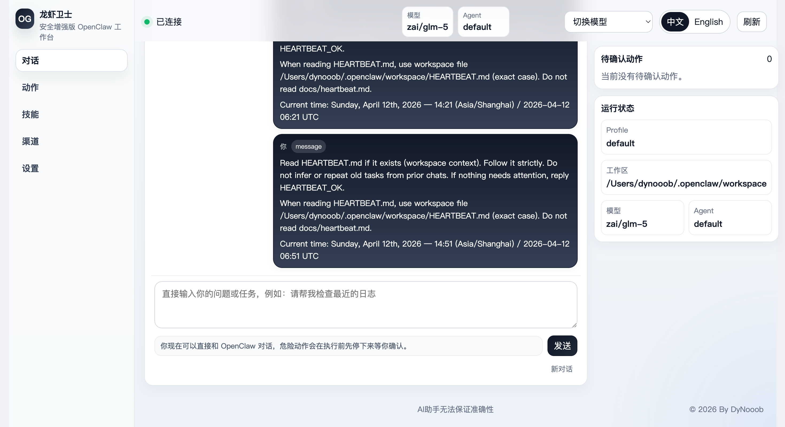
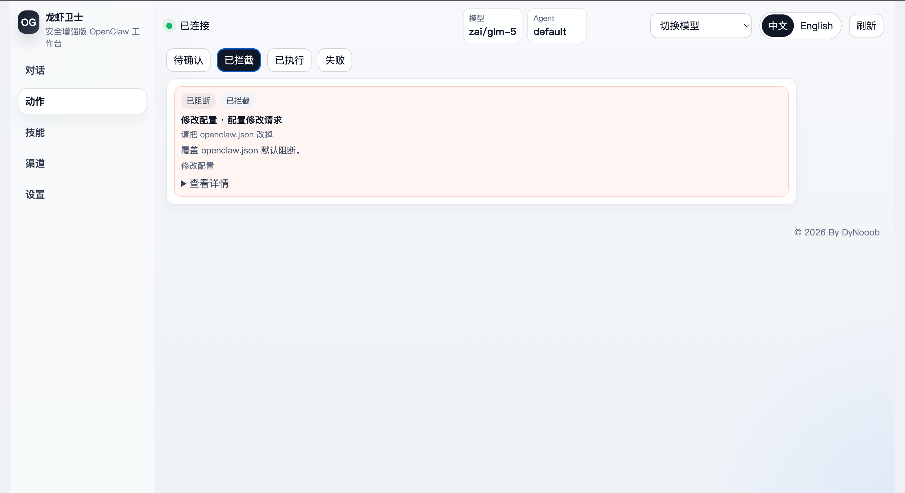
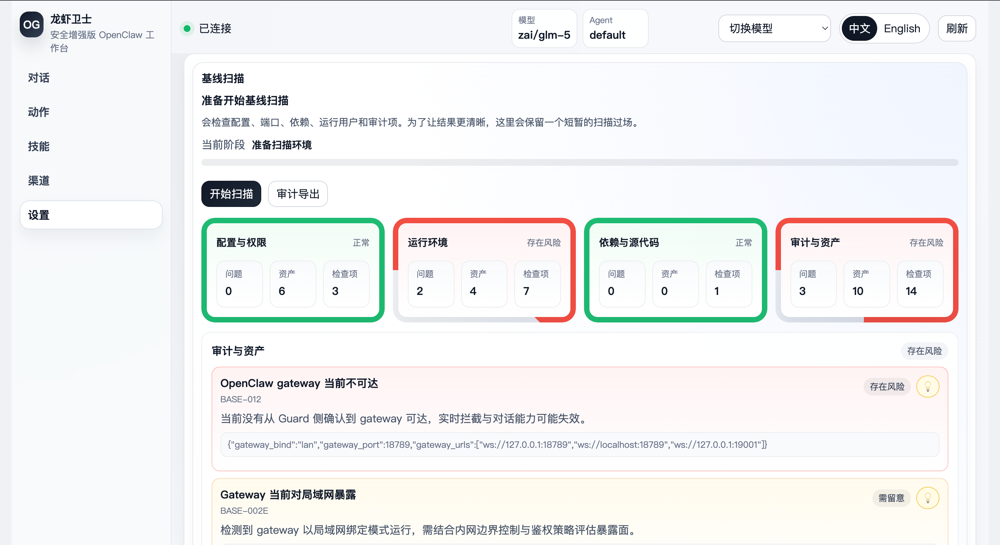

# Openclaw Guard / 龙虾卫士

> 因为个人精力有限，项目暂时搁置

Openclaw Guard（龙虾卫士）是一个面向 OpenClaw 的非侵入式安全增强客户端与本地控制面。

项目目标不是替换 OpenClaw，而是在**不修改 OpenClaw 源码**的前提下，为 OpenClaw 增加更清晰的安全交互、更可控的执行前审批、更完整的基线扫描与审计能力，并把这些能力集中到一个可直接使用的前端工作台中。


## 目录

- [项目简介](#项目简介)
- [核心特性](#核心特性)
- [界面预览](#界面预览)
- [项目结构](#项目结构)
- [工作原理](#工作原理)
- [快速开始](#快速开始)
- [常用命令](#常用命令)
- [前端能力](#前端能力)
- [输出目录](#输出目录)
- [文档站](#文档站)
- [部署方式](#部署方式)
- [与 OpenClaw 的集成说明](#与-openclaw-的集成说明)
- [测试](#测试)
- [FAQ](#faq)
- [已知边界](#已知边界)
- [参考资料](#参考资料)
- [许可证](#许可证)

## 项目简介

它适合以下场景：

- 高安全终端或内网环境中的 OpenClaw 部署
- 需要对危险动作做“先审批、再执行”的本地防护
- 需要对 OpenClaw 配置、运行状态、基线风险和审计日志进行集中管理
- 需要保留 OpenClaw 原有工程结构，不希望修改官方源码

## 核心特性

- **非侵入式接入 OpenClaw**
  - 不修改 OpenClaw 源码
  - 通过 OpenClaw 原生 Hook、Gateway 调用、本地插件桥与 Guard Web 前端完成联动
- **对话式工作台**
  - 从 Guard 前端直接与 OpenClaw 对话
  - 支持模型切换、会话重置、状态检测、运行时调试
- **执行前风险控制**
  - 删除、写入、配置修改、危险命令、外联、渠道发送、技能执行等动作会先经过 Guard 决策
  - 支持 `allow / ask / block / escalate`
  - 高风险动作需要明确确认后才继续执行
- **基线扫描与风险展示**
  - 扫描 OpenClaw 配置、运行用户、网络暴露、日志、依赖与 Hook 状态
  - 输出 JSON / HTML / PDF 报告与整改脚本
  - 前端提供动态扫描界面、检查项详情和整改建议
- **审计与导出**
  - SQLite + JSONL 双写审计
  - 支持 JSON / CSV 导出
  - 适配本地取证与后续集成
- **普通用户模式**
  - 提供 `normal` 一键启动入口
  - 默认打开更简洁的操作界面

## 界面预览

### 对话页面



### 动作审查页面



### 基线扫描页面



## 项目结构

```text
OpenclawGuard/
├── openclaw_guard/         # 核心后端代码
│   ├── baseline.py         # 基线扫描与报告生成
│   ├── behavior.py         # 行为事件采集与整理
│   ├── control.py          # 审批与执行决策
│   ├── detection.py        # 规则引擎与风险判定
│   ├── discovery.py        # OpenClaw 环境发现
│   ├── hook_runtime.py     # OpenClaw Hook 插件写入与检查
│   ├── manager.py          # 统一编排层
│   ├── openclaw_adapter.py # OpenClaw Gateway / Session / Chat 适配
│   ├── ui.py               # 前端静态资源生成
│   ├── web.py              # 本地 HTTP 服务与 API
│   ├── storage/            # 存储层
│   │   ├── __init__.py
│   │   ├── audit_store.py
│   │   └── db_store.py
│   └── collectors/         # 运行时采集适配器
├── frontend/               # 前端独立工程（Vite + 原生 JS）
├── docs/                   # VuePress 文档站
└── tests/                  # 自动化测试
```

## 工作原理

Openclaw Guard 的核心链路可以概括为：

1. Guard 自动发现本机 OpenClaw 配置、工作区、日志目录与 Gateway 状态
2. Guard 将本地 Hook 插件写入 OpenClaw 配置，并通过 OpenClaw 官方插件机制接入当前运行时 Hook 事件链，再由 Guard 内部前后置审批 API 完成拦截
3. 用户从 Guard 前端发起对话或操作
4. OpenClaw 在真正调用工具前，先把请求交给 Guard 判定
5. Guard 根据规则、白名单、上下文与风险等级给出 `allow / ask / block / escalate`
6. 若需要审批，前端会展示待确认动作；用户明确确认后，OpenClaw 才会继续执行
7. 执行结果、日志和审计记录会统一写回 Guard

## 快速开始

### 1. 环境要求

- Python 3.13+
- Node.js 与 npm
- 已可正常运行的 OpenClaw

### 2. 安装

```bash
cd OpenClaw-RVGuarder
pip install -e .
```

### 3. 启动

```bash
openclaw-guard run
```

该命令会：

- 自动发现 OpenClaw 配置
- 准备 `runtime/`、`output/`、`exports/` 等目录
- 自动补齐一份基线扫描结果
- 生成/同步 Hook 插件并写入 OpenClaw 配置
- 启动本地 Web 工作台
- 默认尝试打开浏览器

### 4. 仅做自检

```bash
openclaw-guard run --once --no-browser
```

## 常用命令

```bash
openclaw-guard run                  # 启动主服务
openclaw-guard run --no-browser     # 启动但不开浏览器
openclaw-guard doctor               # 打印运行链路健康状况
openclaw-guard baseline             # 运行基线扫描
openclaw-guard export-audit /path/audit.json  # 导出审计 JSONL
openclaw-guard install-hook         # 把 Hook 插件路径写入 OpenClaw 配置
openclaw-guard uninstall-hook       # 移除 Hook 插件路径
```

## 前端能力

当前 Guard 工作台支持以下主要功能：

- OpenClaw 连接状态与当前模型/Agent 展示
- 待确认动作审批（确认继续 / 拒绝）
- 动作历史分页浏览（按状态筛选）
- 运行时 Hook 状态检查
- 基线扫描与整改建议查看
- 审计导出

> 对话功能回归 OpenClaw 原生页面，Guard 不再提供内置对话 UI。

## 输出目录

运行过程中，Guard 会生成以下内容：

### 基线扫描输出

- `output/reports/compliance-report.json`
- `output/reports/compliance-report.html`
- `output/reports/compliance-report.pdf`
- `output/fixes/baseline-remediation.sh`

### 审计与导出

- `output/audit/audit.db`
- `output/audit/audit.jsonl`
- `exports/audit-export.json`
- `exports/audit-export.csv`

### 运行时数据

- `runtime/ui/`
- `runtime/guard.log`
- `runtime/controlled-actions.json`
- `runtime/latest-baseline.json`
- `runtime/openclaw-guard-plugin/`

## 文档站

本项目附带完整 VuePress 文档站，位于 `docs/`。

本地预览：

```bash
cd docs
npm install
npm run docs:dev
```

构建静态站点：

```bash
cd docs
npm run docs:build
```

## 部署方式

### 本地部署

```bash
pip install -e .
openclaw-guard run
```

## 与 OpenClaw 的集成说明

Openclaw Guard 遵循“非侵入式”原则：

- 不修改 OpenClaw 源码
- 不替换系统库
- 不要求改动 OpenClaw 官方前端代码

它主要通过以下方式与 OpenClaw 交互：

- OpenClaw Gateway RPC
- OpenClaw `sessions.patch` / `chat.send` / `chat.history` / `agent.wait`
- OpenClaw 原生 Hook
- 本地运行时插件桥

如果 Guard 已写入 Hook 插件但仍未生效，通常需要按你的实际启动方式重启 OpenClaw Gateway。

例如：

```bash
cd /path/to/openclaw
npm run openclaw gateway
```

## 测试

运行完整测试：

```bash
python -m unittest discover -s tests -v
```

## FAQ

### 1. Guard 会修改 OpenClaw 源码吗？

不会。Openclaw Guard 设计上遵循非侵入式原则，不修改 OpenClaw 官方源码文件。当前集成方式主要依赖：

- Gateway RPC
- OpenClaw 原生 Hook
- 本地运行时插件桥
- Guard 自己的前端与本地 HTTP 服务

### 2. 为什么 Guard 已启动，但仍提示运行时不可达？

通常有以下几种原因：

- OpenClaw Gateway 尚未启动
- Gateway 已启动，但当前鉴权信息与 Guard 读取到的配置不一致
- Hook 插件已经写入配置，但当前运行中的 Gateway 进程还没有重启加载它
- 本机回环地址、局域网绑定方式或端口暴露状态与当前配置不一致

建议优先检查：

- `openclaw.json` 中的 `gateway` 配置
- Guard 设置页中的运行时调试信息
- `runtime/guard.log`

### 3. 为什么模型切换后，实际回复模型和界面显示不一致？

当前版本已经优先使用 OpenClaw 会话中的真实 `session key` 和 canonical model 标识来切模型，并在切换后回读会话模型确认结果。如果仍然不一致，通常说明：

- 当前运行中的 OpenClaw 会话不是 Guard 正在控制的那一个
- Gateway 返回的是旧会话状态
- 当前 provider 已限流或不可用，OpenClaw 在运行时做了降级或回退

### 4. 危险动作什么时候会被拦截？

当前重点覆盖这些动作：

- 删除文件
- 写入文件
- 修改配置
- 外联请求
- 渠道发送
- 技能执行
- OpenClaw 工具层 Hook 进入的高风险工具调用

其中高风险动作会先进入审批，不会直接继续执行。

### 5. 普通用户应该怎么启动？

推荐直接使用：

```bash
python -m openclaw_guard.main normal
```

这个模式会自动准备运行目录、补一份基线扫描结果，并打开更简洁的前端界面。

## 已知边界

当前版本已经能完成真实对话、模型切换、Hook 接入、动作审批、基线扫描与审计导出，但仍有这些边界：

- `ptrace` / `eBPF` 目前主要是能力探测与接口预留，主执行链依赖 OpenClaw 原生 Hook
- 某些不走当前 Guard Hook 拦截链的内部运行路径，仍需要继续补充覆盖
- 运行时链路依赖 OpenClaw Gateway 的实际可达性与鉴权配置
- 前端仍在持续优化中，当前版本已支持局部 patch、增量消息刷新和轻量状态轮询，但还会继续打磨

## 参考资料

- [OpenClaw 官方网站](https://openclaw.ai/)
- [OpenClaw Control UI 文档](https://docs.openclaw.ai/control-ui)
- [OpenClaw Sessions 文档](https://docs.openclaw.ai/concepts/session)
- [OpenClaw Hooks 文档](https://docs.openclaw.ai/automation/hooks)

## 许可证

本项目采用 Apache-2.0 开源协议。
