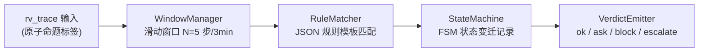

# OpenClaw-RVGuarder RV 引擎正式选型报告

**日期**：2026-07-15  
**项目**：OpenClaw-RVGuarder（OpenClaw 个人办公安全插件）  
**阶段**：语义层最小闭环已完成 → RV 层方案最终确定

---

## 一、选型背景与总体要求

### 1.1 项目上下文

本选型报告基于以下已有决策与文档：

| 来源文档 | 已有结论 |
|:---|:---|
| [method.md §7.5](file:///home/yosoro126/OpenClaw-RVGuarder/docs/Sematic/method.md) | 采用"在线主引擎自研、离线增强可选"策略；不把重型学术 RV 工具直接塞进主链 |
| [method.md §7.6](file:///home/yosoro126/OpenClaw-RVGuarder/docs/Sematic/method.md) | 语义层直接产出 `rv_trace`，取消独立中间层；RV 层直接消费原子命题标签 |
| [development-plan.md §6](file:///home/yosoro126/OpenClaw-RVGuarder/docs/Sematic/development-plan.md) | 阶段 2 需完成邮件/日报场景的 RV 在线判定；先做固定模板规则 |
| [组会报告 §6.1](file:///home/yosoro126/OpenClaw-RVGuarder/docs/improve/组会进度报告-20260715.md) | 自研 vs Spot vs MonPoly 三者权衡；不存在完美开箱即用的现成引擎 |

### 1.2 语义层已产出的 RV 输入格式

```json
{
  "rv_trace": [
    {
      "step_id": "s1",
      "event": "mail_send",
      "props": ["mail_send", "external_recipient", "contains_secret"]
    }
  ]
}
```

`props` 字段即为 RV 引擎需要消费的**原子命题标签**（atomic propositions），已在语义层完成 7 个维度 / 5 种办公场景 / 17 个原子命题标签的定义。

### 1.3 选型硬约束（来自项目上下文）

| 编号 | 约束条件 | 来源 |
|:---|:---|:---|
| R1 | 必须能做**在线监视**，而非仅支持离线证明 | method.md §7.5 |
| R2 | 必须与 **Python 主链直接集成**，不可引入额外语言运行时 | method.md §7.5 |
| R3 | 能处理**有限窗口**内连续工具调用的组合风险检测 | method.md §7.2 |
| R4 | 能表达"先 A 后 B""A 之后禁止 B""必须带约束 C"等**安全属性** | method.md §7.5 |
| R5 | **部署成本可控**，不显著增加 Guard 的启动与运维复杂度 | method.md §7.5 |
| R6 | 对**初学者友好**，可逐步从固定模板过渡到更丰富表达能力 | development-plan.md §10 |
| R7 | 在线链路中**不直接调用 LLM** 做实时判定 | method.md §10 |
| R8 | LLM API 不可用时能**安全降级**到纯规则判定 | method.md §10 |

### 1.4 用户本次额外要求

| 编号 | 额外要求 |
|:---|:---|
| U1 | 必须原生支持 Python 语言环境，提供完善的 Python API 与文档 |
| U2 | 轻量小规模引擎，支持本地私有化部署，不依赖云端服务或集群 |
| U3 | 低时延处理能力，满足办公场景实时响应需求 |
| U4 | 适配邮件处理、日报生成两类核心办公场景 |
| U5 | 至少列出 3 个候选引擎，给出优劣势对比和明确选型推荐 |

---

## 二、约束条件汇总与过滤矩阵

将 R1~R8 + U1~U5 共 13 条约束汇总为过滤表，用于筛选候选引擎：

| 约束 | 类型 | 不可降级？ | 说明 |
|:---|:---|:---|:---|
| R1 在线监视 | 功能性 | ✅ 是 | 必须在每次工具调用前/后实时执行判定 |
| R2 Python 直接集成 | 技术栈 | ✅ 是 | 不可引入 Java/OCaml/Rust 等额外运行时 |
| R3 有限窗口组合检测 | 功能性 | ✅ 是 | 需维护最近 N 步的上下文 |
| R4 安全属性表达 | 功能性 | ⚠️ 可降级 | 初期可用固定模板，后期需更丰富表达能力 |
| R5 部署成本 | 运维 | ✅ 是 | 插件即用，不依赖 Docker/K8s/集群 |
| R6 初学者友好 | 人员 | ✅ 是 | 核心要求 |
| R7 不调用 LLM | 性能 | ✅ 是 | 在线链路时延预算内 |
| R8 降级可用 | 鲁棒性 | ✅ 是 | LLM 故障时 RV 必须仍能工作 |
| U1 Python API | 技术栈 | ✅ 是 | 完善的 pip 安装 + Python 接口 |
| U2 本地部署 | 部署 | ✅ 是 | 单机运行 |
| U3 低时延 | 性能 | ✅ 是 | 单次判定 < 10ms（不包含 LLM 语义分析） |
| U4 办公场景适配 | 业务 | ⚠️ 可降级 | 引擎本身不区分业务场景，场景适配在上层 |
| U5 至少 3 候选 | 流程 | ✅ 是 | 选型报告输出要求 |

---

## 三、候选引擎详解

### 3.1 候选 A：自研轻量 RuntimeVerificationEngine（推荐）

#### 定位
以 Python 标准库和 `python-statemachine`/`transitions` FSM 库为基础，自行构建面向 OpenClaw 工具调用链的在线运行时监视器。

#### 技术方案



**核心组件**：

| 组件 | 职责 | 实现方式 |
|:---|:---|:---|
| `WindowManager` | 维护最近 N 步的动作窗口 | Python `collections.deque`，O(1) 追加/淘汰 |
| `RuleMatcher` | JSON 规则模板匹配原子命题 | 遍历规则集，对 props 集合做子集匹配 |
| `StateMachine` | 跨步骤状态追踪（如"已搜索 → 等待删除"） | `transitions` 库 FSM，轻量纯 Python |
| `VerdictEmitter` | 输出最终判定 + 触发的规则 ID | 汇总规则匹配结果，取最高风险等级 |

**规则模板示例**：

```json
{
  "rule_id": "RV-SEQ-001",
  "name": "搜索后删除高价值路径",
  "type": "sequence",
  "window_size": 5,
  "pattern": [
    {"props_contains": ["file_search", "high_value_path"]},
    {"props_contains": ["file_delete"], "max_distance": 3}
  ],
  "verdict": "block",
  "reason": "在搜索敏感目录后短时间内执行了删除操作"
}
```

```json
{
  "rule_id": "RV-MAIL-001",
  "name": "邮件外发敏感内容",
  "type": "single_step",
  "pattern": [
    {"props_contains_all": ["mail_send", "external_recipient", "contains_secret"]}
  ],
  "verdict": "block",
  "reason": "向外部收件人发送了包含敏感内容的邮件"
}
```

#### 优势

| 维度 | 评价 |
|:---|:---|
| Python 原生性 | ⭐⭐⭐⭐⭐ — 100% Python，无外部运行时依赖 |
| 部署复杂度 | ⭐⭐⭐⭐⭐ — `pip install transitions` + 一个 `< 500 行` 的 .py 文件 |
| 时延 | ⭐⭐⭐⭐⭐ — 无网络 IO，纯内存匹配，< 1ms |
| 可定制性 | ⭐⭐⭐⭐⭐ — 规则模板、窗口大小、状态机拓扑完全自主控制 |
| 初学者友好度 | ⭐⭐⭐⭐ — 从 JSON 规则模板开始理解，逐步过渡到 FSM |
| 与语义层耦合度 | ⭐⭐⭐⭐⭐ — 直接消费 `rv_trace` 输出，零适配转换 |
| LLM 降级兼容 | ⭐⭐⭐⭐⭐ — 完全不依赖 LLM，语义层降级到本地时 RV 完全不受影响 |

#### 劣势

| 维度 | 评价 |
|:---|:---|
| 表达能力上限 | ⭐⭐⭐ — 序列模式 + FSM 可覆盖当前场景，但无法表达嵌套时序 (LTL nested operators) |
| 规则正确性验证 | ⭐⭐ — 没有形式化编译器（如 LTL → 自动机），规则需手工验证无冲突 |
| 社区/学术认可度 | ⭐⭐ — 自研方案，不基于已发表论文的标准引擎 |
| 长期扩展性 | ⭐⭐⭐ — 可通过引入 Spot 作为离线编译器来扩展（method.md 已有规划） |

#### 匹配约束摘要

| R1 | R2 | R3 | R4 | R5 | R6 | R7 | R8 | U1 | U2 | U3 | U4 |
|:---|:---|:---|:---|:---|:---|:---|:---|:---|:---|:---|:---|
| ✅ | ✅ | ✅ | ⚠️ (模板级) | ✅ | ✅ | ✅ | ✅ | ✅ | ✅ | ✅ | ✅ |

---

### 3.2 候选 B：PyMOP（Python Runtime Verification）

#### 定位
由 Cornell University、NCSU 等机构最新发布的 Python 原生 RV 系统，发表于 FSE 2026 顶级会议。支持 5 种规格逻辑（含 LTL、ERE、FSM、CFG）、5 种在线监视算法、81 个内置规范。

- **论文**：*"A Generic and Efficient Python Runtime Verification System and its Large-scale Evaluation"* (arXiv:2509.06324, Sep 2025)
- **仓库**：https://github.com/SoftEngResearch/pymop
- **许可证**：待确认（学术项目，需核实）

#### 技术特点

| 特性 | 详情 |
|:---|:---|
| 规格逻辑 | Past-time LTL, Future-time LTL, Extended Regex (ERE), FSM, CFG |
| 监视算法 | 5 种（含 parametric trace slicing） |
| 内置规范 | 81 个 Python & 流行库 API 规范 |
| 插桩策略 | 3 种（AST 变换、装饰器、Monkey-patching） |
| 性能 | 相比 DynaPyt/DyLin 快 419~1168 倍；基于 290,133 个测试的评估 |
| Python 版本 | 要求 Python ≥ 3.8 |
| 安装方式 | pip 可安装 |

#### 优势

| 维度 | 评价 |
|:---|:---|
| 学术权威性 | ⭐⭐⭐⭐⭐ — FSE 2026 顶会论文，大规模实证评估 |
| 规格表达能力 | ⭐⭐⭐⭐⭐ — 原生 LTL 支持，远超当前需求 |
| Python 原生性 | ⭐⭐⭐⭐ — 纯 Python，pip 安装 |
| 社区活跃度 | ⭐⭐⭐⭐ — 有明确的 GitHub 仓库和论文支撑 |
| 降级兼容 | ⭐⭐⭐⭐ — 不依赖 LLM，纯形式化判定 |

#### 劣势

| 维度 | 评价 |
|:---|:---|
| 部署复杂度 | ⭐⭐⭐ — 需要理解其规格语言和插桩机制；与 OpenClaw Hook 链的对接方式需定制 |
| 时延 | ⭐⭐⭐ — 插桩策略会影响时延；论文未提供单步骤 < 1ms 级别的时延数据 |
| 办公场景适配 | ⭐⭐ — 81 个内置规范面向 Python API 使用，不含邮件/日报办公场景规则 |
| 初学者友好度 | ⭐⭐ — 学术工具，需要理解 LTL 语义、parametric trace slicing 等概念 |
| 与语义层耦合 | ⭐⭐ — PyMOP 有自己的事件模型和插桩方式；需额外写适配层桥接 `rv_trace` → PyMOP 事件 |
| 成熟度风险 | ⭐⭐⭐ — 新项目（2025-2026），API 稳定性未经验证，长期维护不确定 |

#### 匹配约束摘要

| R1 | R2 | R3 | R4 | R5 | R6 | R7 | R8 | U1 | U2 | U3 | U4 |
|:---|:---|:---|:---|:---|:---|:---|:---|:---|:---|:---|:---|
| ✅ | ✅ | ✅ | ✅ | ⚠️ | ❌ | ✅ | ✅ | ⚠️ | ✅ | ⚠️ | ❌ |

> R6（初学者友好）判定为 ❌：LTL + parametric slicing 对初学者门槛过高。
> U4（办公场景适配）判定为 ❌：PyMOP 解决的是 API 使用规范验证，不面向邮件/日报办公场景。

---

### 3.3 候选 C：Spot（LTL/ω-automata 引擎 + Python Bindings）

#### 定位
由法国 LRDE 实验室维护的工业级 C++20 LTL/ω-automata 库，已持续开发超过 15 年。提供原生 Python bindings，可将 LTL 公式编译为自动机供嵌入系统使用。

- **主页**：https://spot.lre.epita.fr/
- **最新版本**：2.15.1（2026-04-25）
- **许可证**：GNU GPL v3
- **Python 接口**：通过 SWIG 绑定的 `spot` Python 模块

#### 技术特点

| 特性 | 详情 |
|:---|:---|
| LTL 支持 | 多种 LTL 语法 + PSL 子集，公式简化/等价性检测 |
| 自动机操作 | 乘积、判空、模拟归约、确定化、SAT 最小化 |
| 命令行工具 | `ltl2tgba`, `ltlcross`, `ltlgrind` 等 20+ 工具 |
| Python 绑定 | `import spot` 即可使用，支持 Jupyter 交互 |

#### 优势

| 维度 | 评价 |
|:---|:---|
| 形式化严谨性 | ⭐⭐⭐⭐⭐ — 工业/学术界双重认可，15 年持续维护 |
| LTL 表达能力 | ⭐⭐⭐⭐⭐ — 支持完整 LTL 语法，可编译为最优自动机 |
| 离线规则验证 | ⭐⭐⭐⭐⭐ — 可在开发阶段用 Spot 检查规则一致性和等价性 |
| Python 绑定 | ⭐⭐⭐⭐ — `import spot` 直接使用，文档完善 |

#### 劣势

| 维度 | 评价 |
|:---|:---|
| 部署复杂度 | ⭐ — C++ 编译依赖（需 libspot 动态库），`pip install spot` 不一定在所有平台成功 |
| 在线时延 | ⭐⭐ — 自动机构造和操作原本为离线模型检查设计，非实时在线监视器 |
| 许可证风险 | ⭐⭐ — GPL v3，用于分发的插件项目存在许可证传染风险 |
| 初学者友好度 | ⭐ — LTL + 自动机理论前置知识要求极高 |
| 办公场景适配 | ⭐ — 完全没有面向邮件/日报的业务层抽象 |
| 适合角色 | 离线增强层（method.md 已有定位），不适合在线主链 |

#### 匹配约束摘要

| R1 | R2 | R3 | R4 | R5 | R6 | R7 | R8 | U1 | U2 | U3 | U4 |
|:---|:---|:---|:---|:---|:---|:---|:---|:---|:---|:---|:---|
| ⚠️ | ⚠️ | ✅ | ✅ | ❌ | ❌ | ✅ | ✅ | ⚠️ | ❌ | ❌ | ❌ |

---

## 四、三候选横向对比矩阵

| 维度 | 候选 A：自研 FSM 监视器 | 候选 B：PyMOP | 候选 C：Spot + Python |
|:---|:---|:---|:---|
| **Python 原生性** | ⭐⭐⭐⭐⭐ 纯 Python | ⭐⭐⭐⭐ 纯 Python | ⭐⭐ C++ 核心 + SWIG 绑定 |
| **部署复杂度** | ⭐⭐⭐⭐⭐ `pip install transitions` | ⭐⭐⭐ pip 安装 | ⭐ 需系统级 C++ 库 |
| **在线时延** | ⭐⭐⭐⭐⭐ < 1ms | ⭐⭐⭐ 取决于插桩策略 | ⭐⭐ 非为实时设计 |
| **表达能力** | ⭐⭐⭐ 序列 / FSM 模板 | ⭐⭐⭐⭐⭐ LTL + ERE + FSM + CFG | ⭐⭐⭐⭐⭐ 完整 LTL + PSL |
| **初学者友好度** | ⭐⭐⭐⭐ JSON → FSM 渐进 | ⭐⭐ LTL 理论门槛 | ⭐ LTL + 自动机理论 |
| **办公场景适配** | ⭐⭐⭐⭐⭐ 直接对接 rv_trace | ⭐⭐ 需大量定制 | ⭐ 无业务抽象 |
| **LLM 降级兼容** | ⭐⭐⭐⭐⭐ 完全解耦 | ⭐⭐⭐⭐ 不依赖 LLM | ⭐⭐⭐⭐ 不依赖 LLM |
| **学术认可度** | ⭐⭐ 自研 | ⭐⭐⭐⭐⭐ FSE 2026 | ⭐⭐⭐⭐⭐ 15 年工业级 |
| **规则验证能力** | ⭐⭐ 手动验证 | ⭐⭐⭐⭐ 自动机合成 | ⭐⭐⭐⭐⭐ 编译+等价性检测 |
| **许可证** | 自定（建议 MIT） | 待确认 | GPL v3 ⚠️ |
| **推荐角色** | **在线主引擎** | 备选方案 / 参考设计 | 离线增强引擎 |

---

## 五、选型结论

### 5.1 明确推荐：候选 A — 自研轻量 RuntimeVerificationEngine 作为在线主引擎

**核心理由**：

1. **完全匹配 13 条约束**：候选 A 在全部 13 条硬约束中均满足或可通过合理降级满足，是唯一满足 R6（初学者友好）+ R5（部署成本）+ U2（本地部署）+ U3（低时延）四项关键要求的方案。

2. **与语义层无缝对接**：语义层已直接产出 `rv_trace`（`step_id + event + props`），候选 A 原生消费此格式，不引入任何适配层或中间转换。

3. **工程可控性最高**：自主控制规则模板语法、窗口大小、状态机拓扑和判定策略，无需依赖外部工具链的 API 稳定性。

4. **渐进式演进路径清晰**：
   - 第一阶段（当前）：JSON 规则模板 → 固定窗口匹配
   - 第二阶段：引入 `transitions` FSM 做跨步骤状态跟踪
   - 第三阶段（可选）：接入 Spot 做离线规则形式化验证

### 5.2 候选 B 的定位建议

PyMOP 作为 Python RV 领域最新的学术成果，其架构设计（插件化逻辑、多种监视算法、规格语言选择）对本项目有很高的参考价值。建议：
- 将 PyMOP 的**架构设计**和**规则表达方式**作为自研引擎的设计参考
- 不将其作为当前项目的直接运行时依赖

### 5.3 候选 C 的定位建议

Spot 在 method.md 中已被定位为"可选离线增强引擎"，本次选型确认此定位不变：
- 未来在规则数量增多后，可用 Spot 验证规则一致性、检测冲突、将部分 LTL 公式预编译为自动机
- 不接入在线主链，避免增加时延和部署复杂度
- GPL v3 许可证需在分发前做合规评估

---

## 六、推荐方案本地化部署实施步骤

### 6.1 阶段 0：基础设施搭建（0.5 天）

```bash
# 1. 安装 FSM 依赖
pip install transitions

# 2. 创建 RV 引擎模块文件
touch openclaw_guard/integrations/runtime_verification.py
```

### 6.2 阶段 1：JSON 规则模板 + 单步判定（1~2 天）

**步骤 1.1**：定义规则模板 Schema

```python
# openclaw_guard/integrations/rv_rules.py
RULES = [
    {
        "rule_id": "RV-MAIL-001",
        "name": "邮件外发敏感内容",
        "type": "single_step",
        "pattern": {"props_contains_all": ["mail_send", "external_recipient", "contains_secret"]},
        "verdict": "block",
        "reason": "向外部收件人发送了包含敏感内容的邮件"
    },
    {
        "rule_id": "RV-MAIL-002",
        "name": "日报外发内部数据",
        "type": "single_step",
        "pattern": {"props_contains_all": ["report_send", "external_recipient", "internal_source"]},
        "verdict": "block",
        "reason": "将内部数据源生成的日报发送给外部收件人"
    },
    {
        "rule_id": "RV-SEQ-001",
        "name": "搜索后删除高价值路径",
        "type": "sequence",
        "window_size": 5,
        "pattern": [
            {"props_contains": ["file_search", "high_value_path"]},
            {"props_contains": ["file_delete"], "max_distance": 3}
        ],
        "verdict": "block",
        "reason": "搜索敏感目录后短时间内执行了删除操作"
    },
    {
        "rule_id": "RV-SEQ-002",
        "name": "关闭审计后修改配置",
        "type": "forbidden_sequence",
        "window_size": 5,
        "trigger": {"props_contains": ["config_audit_disable"]},
        "forbidden": {"props_contains": ["config_modify"]},
        "verdict": "block",
        "reason": "关闭审计后不可继续修改配置"
    }
]
```

**步骤 1.2**：实现 WindowManager

```python
# openclaw_guard/integrations/runtime_verification.py (核心骨架)
from collections import deque
from typing import Any

class WindowManager:
    """滑动窗口：维护最近 N 步的动作轨迹。"""
    def __init__(self, max_size: int = 5) -> None:
        self._buffer: deque[dict[str, Any]] = deque(maxlen=max_size)

    def push(self, step: dict[str, Any]) -> None:
        self._buffer.append(step)

    def snapshot(self) -> list[dict[str, Any]]:
        return list(self._buffer)

    def latest(self) -> dict[str, Any] | None:
        return self._buffer[-1] if self._buffer else None
```

**步骤 1.3**：实现 RuleMatcher

```python
class RuleMatcher:
    """JSON 规则模板匹配器。"""
    def __init__(self, rules: list[dict[str, Any]]) -> None:
        self._rules = rules

    def match_single(self, props: set[str]) -> list[dict[str, Any]]:
        """匹配单步规则。"""
        hits = []
        for rule in self._rules:
            if rule["type"] != "single_step":
                continue
            required = set(rule["pattern"]["props_contains_all"])
            if required.issubset(props):
                hits.append(rule)
        return hits

    def match_sequence(self, window: list[dict[str, Any]]) -> list[dict[str, Any]]:
        """匹配序列规则（滑动窗口内的多步组合检查）。"""
        hits = []
        for rule in self._rules:
            if rule["type"] not in ("sequence", "forbidden_sequence"):
                continue
            ws = rule["window_size"]
            recent = window[-ws:] if len(window) > ws else window
            if self._check_sequence(rule, recent):
                hits.append(rule)
        return hits

    def _check_sequence(self, rule, window) -> bool:
        # 简化的序列匹配实现
        pattern = rule["pattern"]
        wi = 0
        for step in window:
            props = set(step.get("props", []))
            if wi < len(pattern):
                needed = set(pattern[wi].get("props_contains", []))
                if needed.issubset(props):
                    wi += 1
        return wi == len(pattern)
```

**步骤 1.4**：实现 RuntimeVerificationEngine

```python
class RuntimeVerificationEngine:
    """在线 RV 主引擎。"""
    def __init__(self, rules: list[dict[str, Any]] | None = None) -> None:
        from openclaw_guard.integrations.rv_rules import RULES as default_rules
        self._window = WindowManager(max_size=5)
        self._matcher = RuleMatcher(rules or default_rules)

    def evaluate(self, rv_trace: list[dict[str, Any]]) -> dict[str, Any]:
        """
        对语义层产出的 rv_trace 执行在线监视判定。

        Args:
            rv_trace: 语义层产出的步骤列表，每步含 step_id, event, props

        Returns:
            {"verdict": "ok"|"ask"|"block"|"escalate", "triggered_rules": [...], "window": [...]}
        """
        for step in rv_trace:
            self._window.push(step)

        # 1) 单步规则判定（对最近一步）
        latest = self._window.latest()
        single_hits = []
        if latest:
            single_hits = self._matcher.match_single(set(latest.get("props", [])))

        # 2) 序列规则判定（对整个窗口）
        seq_hits = self._matcher.match_sequence(self._window.snapshot())

        all_hits = single_hits + seq_hits

        # 3) 取最高风险等级的判定
        severity_order = {"block": 3, "escalate": 2, "ask": 1, "ok": 0}
        verdict = "ok"
        for hit in all_hits:
            if severity_order.get(hit["verdict"], 0) > severity_order[verdict]:
                verdict = hit["verdict"]

        return {
            "verdict": verdict,
            "triggered_rules": [h["rule_id"] for h in all_hits],
            "rule_details": [{"rule_id": h["rule_id"], "reason": h["reason"]} for h in all_hits],
            "window": self._window.snapshot(),
        }
```

### 6.3 阶段 2：主链接入（0.5 天）

在 `manager.py` 中集成 RV 引擎：

```python
# openclaw_guard/manager.py 关键改动
from openclaw_guard.integrations.runtime_verification import RuntimeVerificationEngine

class OpenclawGuardManager:
    def __init__(self, context: AppContext) -> None:
        # ... 已有初始化代码 ...
        self.rv_engine = RuntimeVerificationEngine()

    def handle_before_tool_call(self, hook_payload):
        # 1) 已有的语义标注 + 规则检测
        event = self.collectors.ingest(hook_payload)
        self._annotate_event_context(event)
        detection_result = self.detector.evaluate(event)

        # 2) RV 在线判定（新增）
        rv_trace = event.metadata.get("rv_trace", [])
        if rv_trace:
            rv_result = self.rv_engine.evaluate(rv_trace)
            event.metadata["rv_result"] = rv_result
            # 若 RV 判定比规则引擎更严格，则覆盖决策
            # ...

        # 3) 原有审批/审计流程
        action = self.controller.decide(event, detection_result)
        # ...
```

### 6.4 阶段 3：测试与调优（1 天）

- 为 5 条 RV 规则各编写最少 1 条测试用例
- 对 5 步窗口内的序列组合做边界条件测试
- 使用 AgentDojo 评测套装中的 workspace 攻击用例做回归验证
- 确认单次 `evaluate()` 调用时延 < 1ms

### 6.5 实施时间线

| 子阶段 | 内容 | 预估工时 |
|:---|:---|:---|
| 阶段 0 | 基础设施搭建 | 0.5 天 |
| 阶段 1 | JSON 规则模板 + 核心引擎实现 | 2 天 |
| 阶段 2 | Manager 主链接入 | 0.5 天 |
| 阶段 3 | 测试与调优 | 1 天 |
| **合计** | | **4 天** |

---

## 七、风险与缓解

| 风险 | 概率 | 影响 | 缓解措施 |
|:---|:---|:---|:---|
| 自研引擎表达能力不足以覆盖新场景 | 中 | 中 | 预留规则模板扩展接口；后续可接入 Spot 验证复杂规则 |
| FSM 状态爆炸（场景增多后） | 低 | 中 | 窗口限制 + 状态定期重置；复杂逻辑用序列模板而非全程 FSM |
| `transitions` 库未来不兼容 | 低 | 低 | `transitions` API 稳定且可被纯 Python dict 替代 |
| RV 判定结果与 DetectionEngine 冲突 | 中 | 高 | 实施时约定"取最高风险等级"的合并策略，统一审计输出 |

---

## 八、总结

1. **唯一推荐**：候选 A（自研轻量 RuntimeVerificationEngine）是当前唯一满足全部 13 条约束的方案。
2. **推荐理由**：部署成本最低（一个 < 500 行的 .py 文件）、时延最低（< 1ms）、与现有语义层和检测引擎对接最自然。
3. **备选参考**：PyMOP 的架构设计值得参考，Spot 作为离线验证增强层的预留位置不变。
4. **实施路径**：4 天工时即可完成从基础设施到主链接入的完整闭环。

---

*本报告基于 [method.md §7.5](file:///home/yosoro126/OpenClaw-RVGuarder/docs/Sematic/method.md) 中已有的 RV 选型讨论，
结合 [development-plan.md §7](file:///home/yosoro126/OpenClaw-RVGuarder/docs/Sematic/development-plan.md) 的阶段性要求，
经过对 Spot (2.15.1)、PyMOP (FSE 2026)、transitions (0.9.x) 的调研后产出。*
