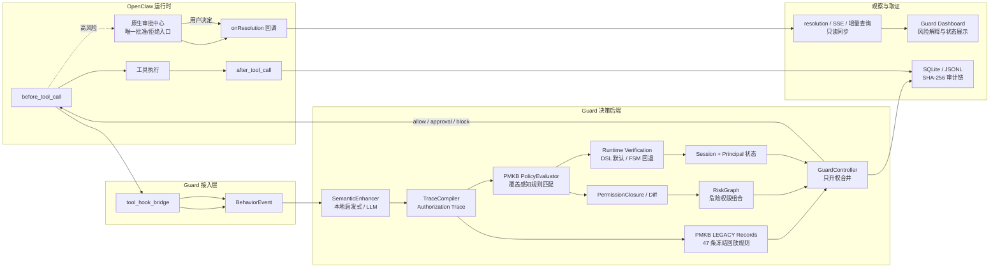
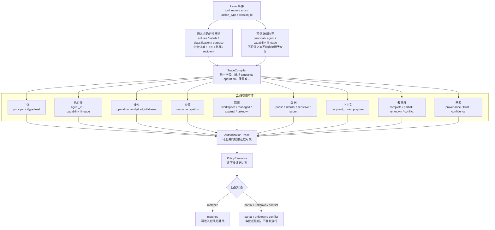
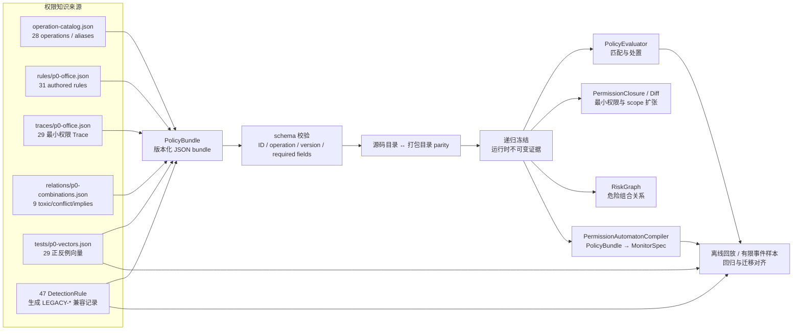
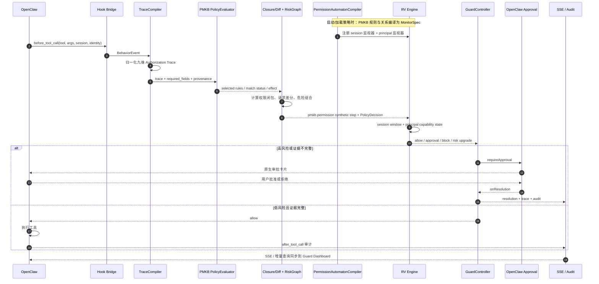

# 权限建模与端到端架构图

> **用途：** 组会汇报图稿
> **核对日期：** 2026-08-31
> **当前实现基线：** v0.7.0-dev / PMKB 1.1.0
>
> Mermaid 是图稿源格式。VuePress 构建后可直接展示；如需放入 PPT，可使用 Mermaid 编辑器或本地工具导出 SVG/PNG。

## 图一：总体架构与 OpenClaw 审批交接

### 讲解要点

- Guard 不修改 OpenClaw 源码，只通过 Hook 接入。
- PMKB 是唯一单步运行时裁决来源；47 条 LEGACY 记录仅保留为可回放兼容数据，RV 负责跨步升权。
- OpenClaw 原生审批页是唯一决策入口，Guard 页面不再创建第二套审批状态。
- `before_prompt_build` 只做审计，不进入 pending approval 队列。

## 图二：权限建模——从工具调用到九维 Authorization Trace

### 讲解要点

- 工具名不是权限本身，必须先解析为 canonical operation，再补齐资源、scope、数据和上下文。
- `unknown` 不是通配符；缺可信 principal 时不能参与跨 Session 继承。
- 匹配分数只用于解释证据，不作为绕过 `unknown/conflict` 的放行开关。

## 图三：PMKB 知识库设计——规则、证据、关系和回归向量

### 讲解要点

- PMKB 不只是规则列表，而是“操作目录 + 规则 + 最小权限证据 + 危险关系 + 回归向量”的完整策略载体。
- 47 条 legacy 规则已经完成兼容迁移和逐条回放；DetectionEngine 已从生产路径删除。
- 加载器在运行前完成 schema、版本、重复 ID、未知 operation 和 parity 校验，并冻结证据对象。

## 图四：PMKB 编译自动机与端到端执行时序

### 讲解要点

1. PMKB 先被编译为标准 `MonitorSpec`，再由 RV 引擎负责窗口、时序和作用域隔离。
2. PMKB 负责“权限结论”，自动机负责“把权限结论纳入运行时监视”；两者不是重复实现。
3. `session-local` 检查当前会话行为链，`principal-global` 检查主体跨会话能力组合。
4. Guard 只升权，不降低既有 `block` 或审批结论；审批结果回到同一条 OpenClaw 生命周期链路。

## 汇报建议

建议按“图二 → 图三 → 图四 → 图一”的顺序讲解：先说明权限如何被建模，再说明知识库如何承载，随后说明如何编译并运行，最后回到系统分层和 OpenClaw 交接。这样“权限建模”是主线，PMKB、自动机和前后端交接分别成为载体、执行机制和落地边界。

相关事实源：

- [权限知识库与 RV 运行时架构结果](./permission-kb-runtime-architecture.md)
- [RV 权限自动机架构](./rv-permission-automata.md)
- [前后端交接改造报告](./frontend-handoff-redesign-report.md)
- [项目理解与当前记忆](./project-memory.md)
