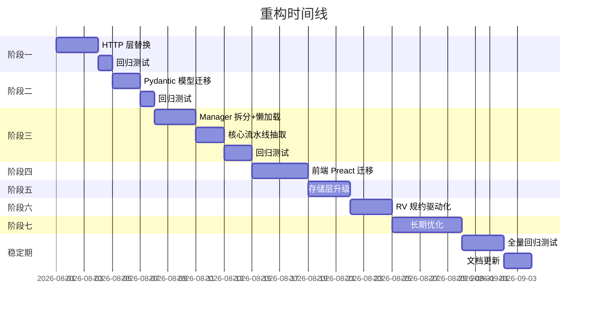

# 渐进式重构实施计划

> 版本：v0.2.1 → v0.3.0（当前） | 日期：2026-07-30（初版）/ 2026-08-01（更新） | 作者：架构评审组
>
> **进度**：阶段一 ✅ 阶段二 ✅ 阶段三 ✅ 阶段四 ✅ 阶段五 ⏳

---

## 1. 基本原则

### 1.1 重构铁律

1. **不阻断业务**：每个阶段结束时，系统必须可运行、可回归测试
2. **零功能变化**：重构期间不新增功能，只做结构优化
3. **蚕食策略**：每次只替换一个组件，验证通过后再推进下一步
4. **测试先行**：对每个被修改的模块，先补充/更新测试再改代码
5. **OpenClaw 合约合规**：`runtime/openclaw-guard-plugin/`、`/api/hook/*` 端点响应格式、`registerGatewayMethod` 声明等涉及 OpenClaw Plugin SDK 合约的代码可以优化，但必须逐项对照 [官方文档](https://openclaw.ai/docs) 验证字段名、类型、行为一致。PR 审查时必须包含"合约合规"检查项

### 1.2 分支策略

```text
main            — 稳定版本（当前 v0.2.1）
refactor/fastapi— 重构分支
    ├── phase-1-http-layer     # 阶段一：HTTP 层替换
    ├── phase-2-models         # 阶段二：Pydantic 模型迁移
    ├── phase-3-manager-split  # 阶段三：Manager 拆分
    ├── phase-4-storage        # 阶段四：存储层升级
    └── phase-5-optimize       # 阶段五：性能优化
```

---

## 2. 阶段划分总览

| 阶段 | 名称 | 预计工期 | 风险等级 | 核心产出 |
|------|------|---------|---------|---------|
| 一 | **HTTP 层替换** | 2-3 天 | ⚡ 中 | FastAPI 路由 + API 端点 |
| 二 | **Pydantic 模型迁移** | 1-2 天 | 🟢 低 | 替换全部 dataclass |
| 三 | **Manager 拆分 + 懒加载** | 3-5 天 | 🔴 高 | 组件独立化 + LazyProxy |
| 四 | **前端 Preact 迁移** | 3-4 天 | 🟡 中 | 组件化 SPA，首屏 ≤ 20KB |
| 五 | **存储层升级** | 2-3 天 | 🟡 中 | SQLite → SQLAlchemy |
| 六 | **RV 规约驱动** | 2-3 天 | 🟢 低 | 声明式 ChainRule |
| 七 | **长期优化** | 持续 | 🟢 低 | 异步、监控、CI |

---

## 3. 阶段一：HTTP 层替换

### 3.1 目标

将 `web.py` + `api/_handlers.py` 从 `BaseHTTPRequestHandler` 迁移到 FastAPI，**不修改任何业务逻辑代码**。

### 3.2 关键路径

```
当前: ThreadingHTTPServer → do_GET/do_POST → _GET_ROUTES/_POST_ROUTES → handlers → manager
目标: uvicorn → FastAPI → APIRouter → handler (Pydantic) → manager
```

### 3.3 实施步骤

**Step 1: 添加 FastAPI 依赖**
```bash
pip install fastapi uvicorn
```
`pyproject.toml` 新增依赖：
```toml
[project.dependencies]
fastapi = ">=0.115.0"
uvicorn = {extras = ["standard"], version = ">=0.30.0"}
```

**Step 2: 创建新文件结构**
```
openclaw_guard/
├── web/
│   ├── __init__.py          # app = FastAPI() + 挂载路由
│   ├── dependencies.py      # DI: get_manager, get_settings
│   ├── errors.py            # 统一异常处理
│   ├── routes/
│   │   ├── __init__.py
│   │   ├── health.py        # GET /api/health
│   │   ├── actions.py       # 动作审批 API
│   │   ├── baseline.py      # 基线扫描 API
│   │   ├── audit.py         # 审计 API
│   │   ├── rv.py            # RV 状态 API
│   │   ├── hook.py          # Hook 桥接 API (before/after/resolve)
│   │   └── static.py        # 前端 SPA 静态文件托管
│   └── models/
│       ├── __init__.py
│       ├── requests.py      # 请求体 Pydantic 模型
│       └── responses.py     # 响应体 Pydantic 模型
```

**Step 3: 实现 `hook.py` 路由（核心——先迁移最高频端点）**
```python
# web/routes/hook.py

from fastapi import APIRouter, Depends, HTTPException, Header
from pydantic import BaseModel

router = APIRouter(prefix="/api/hook", tags=["hook"])

class BeforeToolCallRequest(BaseModel):
    toolName: str
    params: dict = {}
    runId: str = ""
    toolCallId: str = ""
    agentId: str = ""
    sessionKey: str = ""
    sessionId: str = ""

class BeforeToolCallResponse(BaseModel):
    action: str  # "allow" | "require_approval" | "block"
    title: str = ""
    message: str = ""
    severity: str = "warning"
    blockReason: str = ""

@router.post("/before-tool-call", response_model=BeforeToolCallResponse)
async def before_tool_call(
    req: BeforeToolCallRequest,
    manager = Depends(get_manager),
    token: str = Header(None, alias="x-openclaw-guard-token"),
):
    # 鉴权
    if token != manager.settings.GUARD_TOKEN:
        raise HTTPException(status_code=403, detail="invalid token")
    # 委托给现有的 manager 业务逻辑（同步代码通过 asyncio.to_thread 运行）
    import asyncio
    result = await asyncio.to_thread(manager.handle_before_tool_call, req.model_dump())
    return BeforeToolCallResponse(**result)
```

**Step 4: 静态文件托管**
```python
# web/routes/static.py
from fastapi.staticfiles import StaticFiles
from fastapi import APIRouter

router = APIRouter()
router.mount("/", StaticFiles(directory="runtime/ui", html=True), name="spa")
```

**Step 5: 修改 `main.py` 启动入口**
```python
# 当前
def launch_web(manager, host, port):
    server = ThreadingHTTPServer((host, port), make_handler(manager))
    server.serve_forever()

# 目标
def launch_web(manager, host, port):
    from openclaw_guard.web import create_app
    import uvicorn
    app = create_app(manager)
    uvicorn.run(app, host=host, port=port, log_level="info")
```

### 3.4 验收标准

- [ ] 所有 23 个 API 端点可通过 FastAPI 访问并返回与当前一致的结果
- [ ] `/api/health` 返回 200
- [ ] `before_tool_call` 完整流水线通过
- [ ] 前端 SPA 通过 FastAPI 静态文件服务正常加载
- [ ] 所有现有测试通过
- [ ] `openclaw-guard run` 正常启动

### 3.5 回退方案

如果 FastAPI 路由在 2 天内无法稳定运行，恢复为 `BaseHTTPRequestHandler` + 仅在 `_handlers.py` 中引入 Pydantic 做序列化（部分收益）。

---

## 4. 阶段二：Pydantic 模型迁移

### 4.1 目标

将 `models.py` 中所有 `@dataclass` 替换为 `pydantic.BaseModel`，消除手动 `to_dict()`。

### 4.2 实施步骤

**Step 1: 迁移核心模型（1 小时）**
```python
# 当前
@dataclass
class BehaviorEvent:
    event_id: str
    action_type: str
    command: str = ""
    target_paths: list[str] = field(default_factory=list)
    
    def to_dict(self) -> dict:
        return {
            "event_id": self.event_id,
            "action_type": self.action_type,
            ...
        }

# 目标
from pydantic import BaseModel

class BehaviorEvent(BaseModel):
    event_id: str
    action_type: str
    command: str = ""
    target_paths: list[str] = []
    # model_dump() 替代 to_dict()
```

**Step 2: 替换所有 `to_dict()` 调用**
```python
# 搜索所有 to_dict() 调用
grep -r "\.to_dict()" openclaw_guard/
# 替换为 .model_dump() 或 .model_dump(mode="json")
```

**Step 3: 为 API 端点定义请求/响应模型**
```python
# web/models/requests.py
class BeforeToolCallRequest(BaseModel):
    toolName: str = Field(..., description="OpenClaw 工具名称")
    params: dict = Field(default_factory=dict)
    # ...

class ApproveActionRequest(BaseModel):
    action_id: str
    confirm_word: str = ""
```

### 4.3 注意事项

- `pydantic.BaseModel` 与 `@dataclass` 的行为差异：
  - `BaseModel` 默认 `frozen=False`，字段可变
  - `model_dump()` 替代 `dataclasses.asdict()`
  - `model_dump_json()` 替代 `json.dumps(to_dict())`
  - 不需要 `field(default_factory=list)` → 直接用 `list[str] = []`
- 迁移顺序：先迁移纯数据模型（不影响逻辑），再迁移 API 交互模型

---

## 5. 阶段三：Manager 拆分

### 5.1 目标

将 `manager.py` 中的 12 个子组件拆分为独立模块，终结上帝对象反模式。

### 5.2 当前结构

```python
class OpenclawGuardManager:
    def __init__(self, context, db):
        # 12 个子组件
        self.collector = BehaviorCollectorManager()
        self.detector = DetectionEngine()
        self.semantic = SemanticEnhancer(...)
        self.rv_engine = RuntimeVerificationEngine()
        self.whitelist = WhitelistEngine()
        self.controller = GuardController()
        self.audit_store = AuditStore(...)
        self.action_service = ActionService(...)
        self.baseline_service = BaselineService(...)
        self.audit_service = AuditService(...)
        # ...
```

### 5.3 目标结构

```python
# manager.py 不再存在
# 改为依赖注入 + 独立服务

@dataclass
class GuardServices:
    """服务容器 —— 替代 Manager 上帝对象"""
    collector: BehaviorCollectorManager
    detector: DetectionEngine
    semantic: SemanticEnhancer
    rv_engine: RuntimeVerificationEngine
    whitelist: WhitelistEngine
    controller: GuardController
    audit_store: AuditStore
    action_service: ActionService
    baseline_service: BaselineService
    audit_service: AuditService
    adapter: OpenclawAdapter
    discovery: OpenclawDiscovery

# 使用方式
services = build_services(context, db)

# API 路由中
@router.post("/api/hook/before-tool-call")
async def before_tool_call(req: Request, services: GuardServices = Depends(get_services)):
    result = services.detector.evaluate(...)
```

### 5.4 拆分策略

| 步骤 | 操作 | 风险 |
|------|------|------|
| 1 | 提取 `GuardServices` 数据类，将 manager 的 `__init__` 变为聚合函数 | 🟢 |
| 2 | 将 `summary()`、`hook_status()` 等状态查询方法拆分到各自的模块 | 🟢 |
| 3 | 将 `ingest_event()`、`handle_before_tool_call()` 等协调方法抽取为独立流水线 | 🟡 |
| 4 | 移除 `manager.py`，只保留 `build_services()` 工厂函数 | 🔴 |
| 5 | 更新所有引用（`web.py`、`main.py` 等） | 🟡 |
| 6 | 所有非热路径组件改为 `LazyProxy` 懒加载 | 🟢 |

### 5.5 懒加载实现

Manager 拆分是引入懒加载的最佳时机。核心改动：

```python
# 热路径（启动时创建）
services = GuardServices(
    detector=DetectionEngine(),          # <1ms
    semantic=SemanticEnhancer(...),      # <1ms
    controller=GuardController(),        # <1ms
    whitelist=WhitelistEngine(),         # <1ms
    db_store=SQLiteStore(path),          # ~50ms
)

# 懒加载（首次使用时自动创建）
services.rv_engine   # → 创建 RuntimeVerificationEngine（~500ms）
services.adapter     # → 创建 OpenclawAdapter + discovery（~800ms）
services.baseline    # → 首次访问时运行基线扫描（~2-5s）
```

实现 `LazyProxy` 仅需 ~30 行代码：

```python
import threading

class LazyProxy:
    def __init__(self, factory):
        self._factory = factory
        self._instance = None
        self._lock = threading.Lock()  # 线程安全：多线程同时首次访问时只创建一次
    
    def _get(self):
        if self._instance is None:
            with self._lock:
                if self._instance is None:  # double-checked locking
                    self._instance = self._factory()
        return self._instance
    
    def __getattr__(self, name):
        return getattr(self._get(), name)
```

### 5.6 验收标准

- [ ] Manager 不再存在，替换为 `GuardServices` + pipeline/
- [ ] 启动时只创建热路径组件（detector, semantic, controller, whitelist）
- [ ] `openclaw-guard run` → 服务就绪 ≤ 2 秒
- [ ] 现有 `before_tool_call` 流水线功能不变

---

## 6. 阶段四：前端 Preact 迁移

### 6.1 目标

将前端从 Vanilla JS（35k 行 app.js）渐进迁移到 Preact 组件化 SPA，大幅提升可维护性，同时压缩首屏体积。

### 6.2 选型理由：Preact

| 框架 | 体积 | 为何选中 |
|------|------|---------|
| **Preact** | 3KB gzip | 兼容 React API，生态最丰富，Vite 官方插件，学习成本为零 |
| React | 34KB | 体积太大，不适合安全插件 Dashboard |
| Vue | 16KB | 与当前技术栈不匹配 |
| Svelte | ~0（编译后） | 学习成本高，需一次性重写 |
| Alpine.js | 7KB | 缺乏组件化体系，不适合单页应用 |

### 6.3 迁移步骤

**Step 1: 基础设施（半天）**
```bash
npm install preact @preact/preset-vite zustand
```

`vite.config.js` 增加 Preact 支持：
```js
import { defineConfig } from 'vite';
import preact from '@preact/preset-vite';

export default defineConfig({
  plugins: [preact()],
  build: { outDir: '../runtime/ui' },
});
```

**Step 2: 创建 Preact 入口 + 路由（1 天）**

```jsx
// frontend/src/main.jsx
import { render } from 'preact';
import { App } from './App';

render(<App />, document.getElementById('app'));
```

```jsx
// frontend/src/App.jsx
import { Router } from 'preact-router';
import { Overview } from './pages/Overview';
import { Actions } from './pages/Actions';

export function App() {
  return (
    <div class="app">
      <Navbar />
      <Router>
        <Overview path="/" />
        <Actions path="/actions" />
        <Audit path="/audit" />
        <RvStatus path="/rv" />
        <Baseline path="/baseline" />
      </Router>
    </div>
  );
}
```

**Step 3: 按优先级逐页替换（2-3 天）**

```
优先级 1: Overview（概览页）         ← 首页加载体验最关键
优先级 2: Actions（审批列表）        ← 高频页面
优先级 3: Audit（审计查询）          ← 数据表格，Preact 性能优势明显
优先级 4: RvStatus / Baseline       ← 低频页面最后迁移
```

**Step 4: 状态层（与 Step 2/3 并行）**

```jsx
// frontend/src/stores/useStore.js
import { create } from 'zustand';

export const useGuardStore = create((set) => ({
  summary: null,
  actions: [],
  rvStatus: null,
  fetchSummary: async () => {
    const res = await fetch('/api/summary');
    set({ summary: await res.json() });
  },
}));
```

### 6.4 目录结构（目标）

```
frontend/src/
├── main.jsx              # Preact 入口
├── App.jsx               # 根组件 + 路由
├── api/                  # API 请求层
├── pages/                # 页面组件
├── components/           # 可复用组件
├── stores/               # Zustand 状态管理
└── styles.css            # 精简后全局样式
```

### 6.5 验收标准

- [ ] Preact 入口可正常编译并替代原有 Vanilla JS
- [ ] 所有 5 个页面通过 Preact 组件渲染
- [ ] 构建产物首屏 JS ≤ 20KB gzip
- [ ] 页面间路由切换无闪烁
- [ ] `/api/summary` 等接口调用正常
- [ ] 每个 Preact 组件有对应的测试文件

---

## 7. 阶段五：存储层升级

### 7.1 目标

引入 SQLAlchemy 作为 ORM 层，替代当前的 `SQLiteStore` 原生 SQL 实现。

### 7.2 理由

- 原生 SQL 字符串拼接无类型安全
- 表结构变更需手动迁移
- 无法优雅支持复杂查询
- SQLAlchemy 2.0 的异步支持为未来做准备

### 7.3 保留设计

`DBStoreInterface` 抽象层不动，新增 `SQLAlchemyStore` 实现：

```python
class SQLAlchemyStore(DBStoreInterface):
    def __init__(self, db_url: str):
        self.engine = create_async_engine(db_url)
        self.session = async_sessionmaker(self.engine)
```

`get_db_store()` 工厂函数增加 `"sqlalchemy"` 模式：
```python
def get_db_store(connection_string: str, mode: str = "sqlite") -> DBStoreInterface:
    if mode == "sqlalchemy":
        return SQLAlchemyStore(connection_string)
    elif mode == "postgres":
        return PostgreSQLStore(connection_string)
    else:
        return SQLiteStore(connection_string)
```

---

## 8. 阶段六：RV 规约驱动

### 8.1 目标

将 6 个手写 FSM 监视器替换为声明式 ChainRule，从规约自动生成 FSM。

### 8.2 产出

```python
# rv_rules.py — 唯一的可变部分
RULES = [
    ChainRule(
        id="mail-phishing",
        sequence=[
            StepRequirement(props_any={"external_source", "attachment_open"}),
            StepRequirement(props_any={"contains_secret"}),
            StepRequirement(props_all={"mail_send", "external_recipient"}),
        ],
        verdict="block",
    ),
    ChainRule(
        id="search-delete",
        sequence=[
            StepRequirement(props_all={"file_search", "high_value_path"}),
            StepRequirement(props_all={"file_delete", "high_value_path"}),
        ],
        verdict="block",
        window_size=5,
    ),
    # ... 更多规则只需追加
]
```

详见 `rv-spec-driven-design.md`。

---

## 9. 阶段七：长期优化（持续）

### 9.1 目标

在架构稳定后，持续优化非功能性需求，提升运维效率和工程质量。

### 9.2 优化方向

| 方向 | 具体措施 | 优先级 |
|------|---------|--------|
| **异步化** | 将 LLM API 调用改为 `httpx.AsyncClient`，减少线程占用 | P2 |
| **结构化日志** | 引入 `structlog`，输出 JSON Lines 格式日志 | P1 |
| **Metrics 暴露** | 新增 `/api/metrics` 端点（Prometheus 格式），暴露请求计数、延迟分布、熔断器状态 | P2 |
| **CI/CD** | GitHub Actions 自动化测试 + 构建 + 发布流程 | P1 |
| **类型覆盖** | mypy --strict 全项目零错误 | P1 |
| **前端细化** | Preact 组件测试、无障碍优化、暗色主题 | P2 |

### 9.3 验收标准

- [ ] 结构化日志全项目覆盖
- [ ] CI 流水线：push → ruff → mypy → pytest → build
- [ ] `/api/metrics` 端点可用（Prometheus 文本格式）
- [ ] mypy --strict 零错误

---

## 10. 时间线



---

## 11. 测试策略

### 11.1 每阶段验证

| 阶段 | 验证方式 | 通过标准 |
|------|---------|---------|
| 一 | `openclaw-guard run` 启动测试 | 启动成功，API 响应同旧版本 |
| 一 | curl 测试全部 23 个端点 | 响应格式一致 |
| 二 | `python -m pytest tests/` | 全部通过 |
| 三 | 流水线集成测试 + 启动速度测量 | ingest→detect→decide→audit 完整链路，`openclaw-guard run` ≤ 2秒 |
| 四 | 前端 SPA 加载测试 | 首屏 JS ≤ 20KB gzip |
| 五 | 数据持久化验证 | 写入/读取/审计校验完整 |
| 六 | 规则正确性测试 | 6 类攻击链覆盖无退化 |

### 11.2 并行运行策略

重构期间，新旧两套 HTTP 层可**并行运行**在不同的端口：

```bash
# 旧系统（平稳运行）
openclaw-guard run --port 8780

# 新系统（验证测试）
openclaw-guard run --fastapi --port 8781
```

对比两个端口的 API 响应，确保功能一致后再切换默认端口。

---

## 12. 回退策略

| 风险 | 触发条件 | 回退动作 |
|------|---------|---------|
| 阶段一失败 | FastAPI 路由 2 天不稳定 | 回退到旧 HTTP 层，仅在 handler 中引入 Pydantic |
| 阶段二中断 | Pydantic 模型与现有代码不兼容 | 保留旧 dataclass + 新增 Pydantic 适配层 |
| 阶段三阻塞 | Manager 拆分导致流水线断裂 | 暂缓拆分，先做内部接口提取 |
| 阶段四异常 | SQLAlchemy 迁移导致数据丢失 | 回退到 SQLiteStore，JSON 文件仍有备份 |

---

## 13. 交付物清单

| 阶段 | 交付物 | 格式 |
|------|--------|------|
| 一 | `openclaw_guard/web/` 目录（FastAPI 路由模块） | 源码 |
| 一 | 更新后的 `main.py` | 源码 |
| 二 | `models.py` 中所有 model 改为 Pydantic | 源码 |
| 二 | `web/models/` 目录（API 交互模型） | 源码 |
| 三 | `engine/pipeline.py`（独立流水线） | 源码 |
| 三 | `services.py`（依赖容器） | 源码 |
| 四 | `frontend/src/` Preact 组件 + stores + api 目录 | 源码 |
| 四 | `vite.config.js` 更新（@preact/preset-vite） | 配置 |
| 四 | 前端测试文件 | 源码 |
| 五 | `storage/sqlalchemy_store.py` | 源码 |
| 六 | `engine/rv_rules.py`（声明式规约） | 源码 |
| 六 | `engine/rv_compiler.py`（规约编译器） | 源码 |
| 全 | 更新后的架构文档 | `.md` |

---

## 14. 总工期预算

| 阶段 | 天数 | 风险 |
|------|------|------|
| 一：HTTP 层替换 | 3 天 | ⚡ 中 |
| 二：Pydantic 模型 | 2 天 | 🟢 低 |
| 三：Manager 拆分 + 懒加载 | 5 天 | 🔴 高 |
| 四：前端 Preact 迁移 | 4 天 | 🟡 中 |
| 五：存储层升级 | 3 天 | 🟡 中 |
| 六：RV 规约驱动 | 3 天 | 🟢 低 |
| 七：长期优化 | 5 天 | 🟢 低 |
| 稳定期：回归 + 文档 | 5 天 | 🟢 低 |
| **合计** | **约 30 个工作日** | **4 到 6 周** |
