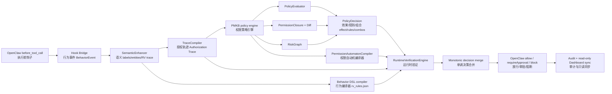
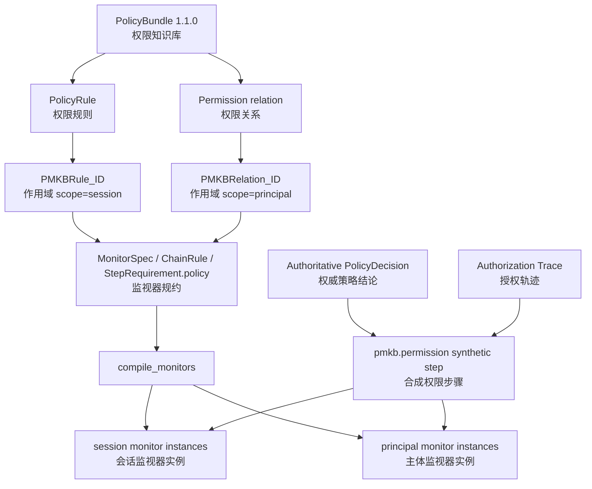
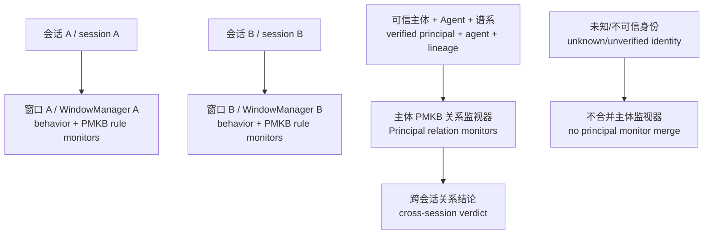

# RV 权限自动机架构

> **状态：** 当前实现
> **核对日期：** 2026-09-03
> **适用版本：** PMKB `1.1.0`、RV 默认 DSL 模式

本文档说明当前 RV 层实际运行的三类自动机、PMKB 如何编译为权限监视器，以及旧 FSM/规则层的迁移边界。它与[权限知识库与权限建模运行时架构结果](./permission-kb-runtime-architecture.md)互补：后者描述权限决策语义，本页描述这些语义怎样进入 RV 编译和在线监控。


## 1. 核心结论

一条实时 Trace **不会生成三台新自动机**。自动机在策略装载或基线训练时生成/学习一次；实时 Trace 只是驱动相应作用域中的既有状态。

| 自动机族 | 生成来源 | 状态作用域 | 主要职责 | 当前地位 |
| --- | --- | --- | --- | --- |
| 行为链监视器 | `rv/rv_rules.json` → ChainRule DSL | session | 搜索→删除、敏感读取→外发等有序行为链 | 默认启用 |
| 权限监视器 | PMKB `rules`、`relations` → `PermissionAutomatonCompiler` | rule 为 session；relation 为 principal | 将确定性权限规则、最小权限/组合结论纳入 RV 审计与处置 | 默认接入 Hook 链路 |
| 基线 DFA | 已确认的正常抽象轨迹 → `BaselineLearner` | 当前 BaselineMonitor 实例 | 发现偏离正常轨迹的异常 | 可选、告警信号 |

旧的 `rv_monitors.py` 六个手写 FSM 仍可通过 `OPENCLAW_RV_RULE_MODE=fsm` 启用，但只作为兼容回退；默认行为规则由 DSL 编译。PMKB 不是第二份硬编码规则：它仍由 `PolicyEvaluator`、`PermissionClosure`、`PermissionDiff` 与 `RiskGraph` 计算语义结论，自动机只消费带来源的确定性证据。

## 2. 端到端架构图



决策顺序有两个不可变约束：

1. PMKB 在 RV 前完成语义判断，未知/冲突/缺字段不能被权限自动机变成放行；
2. 合并只允许风险提高：`allow < ask/revise < escalate < block`。自动机不能覆盖既有 `block`，也不能把 PMKB 审批结论降成 allow。

## 3. PMKB 到自动机的编译合同

`openclaw_guard/policy/rv_compiler.py` 中的 `PermissionAutomatonCompiler` 读取已校验、冻结的 `PolicyBundle`，生成 `Ruleset` 和 `MonitorSpec`。每个监视器保存 `source="pmkb"` 与 `source_ids`，因此审计记录能稳定回链到知识库规则或关系 ID。



### 3.1 规则监视器

每个 `PolicyRule` 生成一个名称为 `PMKBRule_<rule-id>` 的 session 监视器。它匹配如下证据：

- `selected_rule_ids` 包含该规则；
- 实际 `PolicyDecision.effect` 与规则 effect 相同；
- `match_status` 为 `matched` 或 `partial`。

effect 映射为 RV verdict：`auto_allow_audit → ok`、`clarify_then_retry/openclaw_approval → ask`、`block → block`。比较实际 effect 而非只比较候选规则至关重要：例如低风险内部消息的策略例外已经由评估器校准为 allow，权限监视器不能把它重新升级为审批。

### 3.2 组合关系监视器

每个有处置效果的 `relations` 条目生成 `PMKBRelation_<relation-id>` 主体作用域监视器。它匹配 `combo_violations` 和最终 effect，例如：

- `token-egress`：`session.token.read + network.egress + external_target` → `block`；
- `credential-egress`：`credential.read + network.egress + external_target` → `block`；
- `grant-sensitive-export`：新增权限与敏感外发的聚合 → `block`；
- `auth-audit`：身份认证修改与审计修改并存 → `ask`。

这里的“组合是否已经成立”仍由闭包和 RiskGraph 计算，避免把集合、scope、TTL、委派链、资源字段等复杂语义错误压缩为普通 DFA 的有限状态。生成的监视器负责：把已成立组合以 RV 标准 verdict、监视器名称和 timing 输出，并按可信身份隔离其状态与审计。

## 4. DSL 新增的权限守卫

`StepRequirement.policy` 是 RV DSL 的显式权限守卫，字段为：

| 字段 | 解释 |
| --- | --- |
| `rule_ids_any_of` | 最终选中规则的 ID 集合 |
| `combo_violations_any_of` | RiskGraph 命中的组合关系 ID |
| `effects_any_of` | PMKB 最终 effect |
| `match_statuses` | `matched / partial / unknown / conflict` 状态限定 |
| `operation_families` | canonical permission family |
| `permission_families_any_of` | `P_after` 闭包中的权限族 |
| `min_risk_score` | 最小 PMKB 风险分数 |

在线运行时构造的 synthetic step 不包含业务标签（避免把同一动作再次喂给旧行为 FSM），形态如下：

```json
{
  "event": "pmkb.permission",
  "props": ["pmkb", "pmkb:operation:network.egress", "pmkb:relation:token-egress"],
  "policy": {
    "effect": "block",
    "match_status": "matched",
    "combo_violations": ["token-egress"],
    "operation_family": "network.egress",
    "p_after_families": ["session.token.read", "network.egress"]
  }
}
```

这使行为 Trace 与权限 Trace 明确分层：前者用于时序行为识别，后者用于权限状态与决策证据。二者共享同一个 RV 结果接口，但不会互相伪造标签。

## 5. 状态作用域与生命周期



- session 作用域按 `session_id`（回退 `session_key`）隔离，默认窗口 10 步、TTL 300 秒；
- principal 作用域键为 `(principal_id, agent_id, capability_lineage)`；三个维度任一不同都不能共享状态；
- Hook 事件只有 `trusted_identity.trust == verified` 才进入 principal 监视器；文本中声称的身份不具备跨 session 合并资格；
- `PrincipalSecurityState` 的风险历史会持久化到 `runtime/rv-state.json`。权限关系监视器当前采用“每次决策重新验证组合”的确定性模式，不把历史 permission set 当作已授权事实持久化。

最后一点是有意的安全限制：权限集合的权威来源仍是当前 Hook 传入的、经过 grant 校验的 `current_permissions`；重启后不应仅凭历史观察推断用户仍持有某一权限。

## 6. 旧结构迁移状态

| 旧结构 | 当前兼容方式 | 后续迁移目标 |
| --- | --- | --- |
| `rv_rules.json` | 仍是行为链 DSL 的唯一来源 | 只保留跨步行为约束，不承载权限集合语义 |
| `rv_monitors.py` | `fsm` 模式回退 | DSL 覆盖与行为一致性验证完成后移除重复业务 FSM |
| 47 条冻结 LEGACY 元数据 | 已生成同 ID 的 ConstraintRule 和 `LEGACY-<old-id>` PMKB 记录；生产 DetectionEngine 已删除 | 新规则优先建模为主体、资源、范围和权限谓词，LEGACY 仅保留回放证据 |
| `ConstraintEngine` | 继续作可选风险升权 | 可表达的权限谓词迁入 PMKB + `StepRequirement.policy`，仅保留通用约束推理 |
| `BaselineDFA` | 环境变量可选加载 | 保持异常信号，不能成为 allow 的依据 |
| NL2Spec | 生成/校验行为 DSL 的工具 | 不可绕过 PMKB 自动写入生产权限规则 |

迁移原则是“来源收敛、行为兼容、逐条回放”：每一条迁移规则必须有旧 ID→新 PMKB ID 或 DSL ID 的映射、正反例、回放结果和回退开关；历史实验文档保留在 `docs/archive/`，不作为运行时配置来源。

## 7. 可观测性、测试与运维

`RuntimeVerificationEngine.evaluate()` 结果新增 `monitor_sources`：

```json
{
  "behavior": 6,
  "permission": 72,
  "principal_permission": 9
}
```

它与既有 `monitor_timings_ms`、`triggered_by`、`reason`、`baseline_result` 一起进入事件 metadata 和审计。关键测试：

- `tests/test_permission_rv_compiler.py`：规则/关系编译数量、block 投影、principal 隔离；
- `tests/test_rv_dsl.py`、`tests/test_rv_dsl_ext.py`：DSL、序列、实体、参数化和权限守卫兼容；
- `tests/test_policy_vectors.py`、`tests/test_permission_diff.py`、`tests/test_permission_risk_graph.py`：PMKB 语义权威；
- `tests/test_principal_capability_rv.py`、`tests/test_principal_rv_hook_integration.py`：跨 session 身份键、TTL 和持久化；
- 全量 `python -m pytest -q` 与 `npm run docs:build`：代码及文档站回归。

建议的变更顺序：先改 PMKB 数据并运行向量/权限测试，再检查编译出的 `source_ids` 与自动机数量，最后运行 Hook 集成和全量回归。新规则绝不能通过只改 RV DSL 绕过 PMKB 的 schema、版本、来源和回滚元数据。
