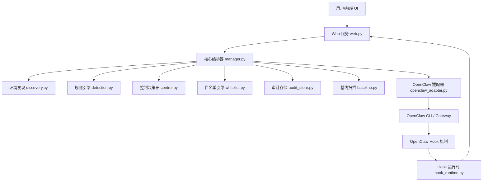

# RVguarder / 龙虾卫士 技术架构梳理文档

## 1. 项目概述

**RVguarder (龙虾卫士)** 是一个为 **OpenClaw** 平台量身定制的非侵入式安全增强系统。它通过拦截、审计和控制 OpenClaw 的运行时行为，为高安全敏感场景提供了强大的防护屏障。

### 1.1 核心设计理念
- **非侵入式 (Non-Intrusive)**: 不修改 OpenClaw 核心源码，通过原生 Hook 机制和 Gateway RPC 通信实现对接。
- **零信任执行 (Zero-Trust Execution)**: 默认对所有高风险操作进行拦截或审批，支持 `allow`、`ask`、`block`、`escalate` 四种决策。
- **可追溯审计 (Auditability)**: 采用 SQLite + JSONL 双写审计，确保所有行为均可溯源、可导出。

---

## 2. 模块划分

项目主要包含以下核心模块，位于 `openclaw_guard/` 目录下：

| 模块名称 | 文件 | 核心职责 |
| :--- | :--- | :--- |
| **入口模块** | `main.py` | 命令行参数解析，根据不同模式（`normal`, `launch`, `baseline` 等）启动应用。 |
| **核心编排器** | `manager.py` | **系统的核心大脑**。负责初始化各子系统，处理前端 API 请求，协调聊天、基线扫描、动作审批等逻辑。 |
| **配置管理** | `config.py` | 定义 `AppPaths`, `OpenClawTarget`, `GuardSettings` 等数据类，管理运行时路径和应用设置。 |
| **环境发现** | `discovery.py` | 自动扫描本地文件系统，定位 OpenClaw 的配置文件、工作区、日志目录及 Gateway 状态。 |
| **OpenClaw 适配器** | `openclaw_adapter.py` | 与 OpenClaw 交互的桥梁。通过调用 `openclaw gateway call` 子进程实现状态检测、消息发送和会话管理。 |
| **规则引擎** | `detection.py` | 内置 47 条预置规则，涵盖命令执行、文件操作、网络外联、技能调用等，对行为事件进行风险判定。 |
| **控制决策器** | `control.py` | 根据规则引擎的输出和白名单匹配结果，生成最终的 `ControlledAction`。 |
| **白名单引擎** | `whitelist.py` | 允许用户对特定操作配置白名单，以绕过部分低风险拦截。 |
| **基线扫描** | `baseline.py` | 对 OpenClaw 的配置安全、网络暴露、运行用户等进行深度扫描，输出合规性报告。 |
| **审计存储** | `audit_store.py` | 负责将行为事件和决策结果持久化存储到 SQLite 数据库和 JSONL 备份文件中。 |
| **Hook 运行时** | `hook_runtime.py` | 负责将 Guard 的拦截插件动态写入 OpenClaw 的配置，并监控插件加载状态。 |
| **Web 服务** | `web.py` | 基于 Python 标准库 `http.server` 实现的本地 HTTP 服务，提供 RESTful API 和静态 UI 资源。 |
| **UI 生成器** | `ui.py` | 动态生成并更新前端 HTML/JS/CSS 资源。 |
| **行为采集器** | `collectors/` | 预留了对 ptrace、eBPF 等底层技术的支持，用于更深层的运行时行为监控。 |

---

## 3. 依赖关系图

---

## 4. 资源配置要求

### 4.1 软件环境
- **Python**: 3.13 或更高版本。
- **Node.js & npm**: 用于构建文档站（可选，运行核心功能非必须）。
- **OpenClaw**: 必须有一个正常运行的 OpenClaw 实例及其 CLI 工具。

### 4.2 硬件资源
- **CPU**: 单核即可满足日常审计需求；基线扫描期间会有短暂的 CPU 峰值。
- **内存**: 基础运行内存占用约 120MB，峰值不超过 200MB。
- **存储**: 审计日志随使用量增长，默认 7 天归档策略。

### 4.3 网络权限
- **本地回环 (127.0.0.1)**: 必须能够访问 OpenClaw Gateway 的默认端口（如 `18789`）。
- **Web 服务端口**: 默认占用 `8780` 端口提供管理界面。

---

## 5. 数据流分析

1. **用户发起请求**：用户在 Guard 前端发送一条指令（例如：`删除 /tmp/secret.txt`）。
2. **拦截与解析**：OpenClaw 触发 `before_tool_call` Hook，请求转发至 Guard 的 `/api/hook/before-tool-call` 接口。
3. **行为事件生成**：Manager 解析请求，生成 `BehaviorEvent` 对象。
4. **规则匹配**：`DetectionEngine` 使用 47 条内置规则对该事件进行扫描，返回风险等级和初步决策。
5. **白名单校验**：`GuardController` 检查该事件是否在白名单内。如果在，则降级为 `allow`。
6. **最终决策**：生成 `ControlledAction`。
    - 若为 `block`：直接拒绝执行。
    - 若为 `ask` 或 `escalate`：进入审批队列，前端弹出确认框。
    - 若为 `allow`：直接放行。
7. **审计记录**：无论结果如何，所有细节均被 `AuditStore` 写入数据库。
8. **结果反馈**：最终状态反馈给 OpenClaw，并更新前端 UI。

---

## 6. 部署兼容性评估（针对 AgentDojo）

为了部署 **AgentDojo** 进行安全评测，我们需要考虑以下兼容性：

1. **Python 版本**: AgentDojo 通常要求 Python 3.9+，而 Guard 要求 3.13+。使用 `conda` 或 `venv` 创建独立环境即可完美共存。
2. **API 交互**: AgentDojo 可以作为一个独立的“黑客”进程，通过 HTTP 请求向运行在 `127.0.0.1:8780` 的 Guard API 发送恶意指令。
3. **结果分析**: Guard 的审计数据库 (`output/audit/audit.db`) 提供了标准的 SQL 接口，AgentDojo 或自定义脚本可以直接读取拦截记录进行成功率分析。

**结论**: 现有架构完全支持引入 AgentDojo 进行自动化安全评测，只需确保两个服务运行在不同的 Python 虚拟环境中即可。
