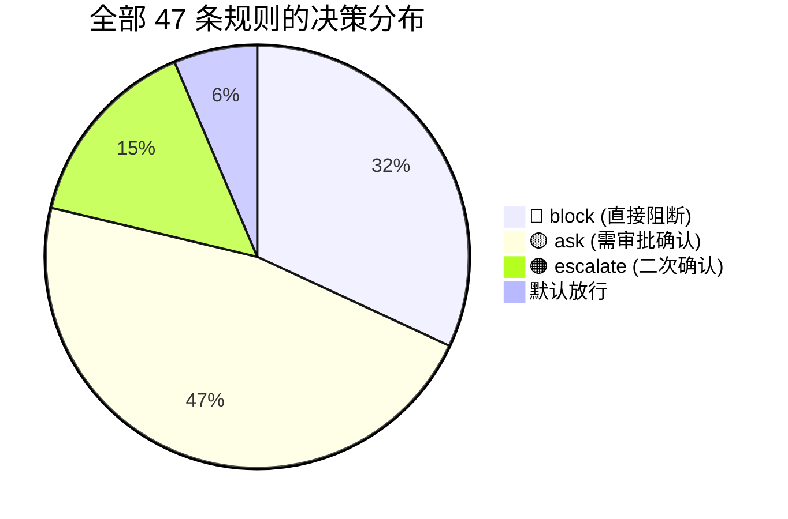

# RVguarder 检测规则集

> **说明**: 本文档列出了 RVguarder 当前集成的全部 47 条内置检测规则（来源于 `detection.py` 的 `builtin_rules()` 函数），按风险类别分类整理。每条规则包含匹配条件、风险等级和决策行为，作为安全评测的前置参考资料。

**规则总数**: 47 条
**数据来源**: `openclaw_guard/detection.py`
**生成时间**: 2026-06-02

---

## 规则决策说明

| 决策 | 标识 | 含义 |
| :--- | :--- | :--- |
| **block** | 🔴 阻断 | 直接拒绝执行，不经过用户确认 |
| **ask** | 🟡 审批 | 转入待审批队列，需用户明确确认后才执行 |
| **escalate** | 🟠 二次确认 | 比 `ask` 更严格，需要用户输入特定的确认文字（如 "EXECUTE"） |
| 未命中 | 🟢 放行 | 无规则命中时，对话类消息默认放行，敏感操作默认转入 `ask` 审批 |

---

## 一、命令执行类 (CMD) — 10 条

检测通过 OpenClaw 执行的系统命令，覆盖文件删除、远程脚本执行、提权等场景。

| 规则 ID | 规则标题 | 匹配条件 | 风险等级 | 决策 | 严重程度 |
| :--- | :--- | :--- | :--- | :--- | :--- |
| CMD-001 | 阻断 rm -rf | command 以 `rm -rf` 开头 | blocked | 🔴 block | critical |
| CMD-002 | 阻断 curl 管道执行 | 同时包含 `curl` 和 `\| sh` | blocked | 🔴 block | critical |
| CMD-003 | 阻断 wget 管道执行 | 同时包含 `wget` 和 `\| bash` | blocked | 🔴 block | critical |
| CMD-004 | 升级 sudo | command 以 `sudo ` 开头 | dangerous | 🟠 escalate | high |
| CMD-005 | 升级 ssh | command 以 `ssh ` 开头 | dangerous | 🟠 escalate | high |
| CMD-006 | 升级 scp | command 以 `scp ` 开头 | dangerous | 🟠 escalate | high |
| CMD-007 | 确认 chmod | command 以 `chmod ` 开头 | dangerous | 🟡 ask | high |
| CMD-008 | 确认 chown | command 以 `chown ` 开头 | dangerous | 🟡 ask | high |
| CMD-009 | 确认 mv | command 以 `mv ` 开头 | caution | 🟡 ask | medium |
| CMD-010 | 确认 rm | command 以 `rm ` 开头 | dangerous | 🟡 ask | high |

---

## 二、文件删除类 (FILE) — 10 条

检测对文件系统的危险删除操作，覆盖系统目录、凭据目录、日志等。

| 规则 ID | 规则标题 | 匹配条件 | 风险等级 | 决策 | 严重程度 |
| :--- | :--- | :--- | :--- | :--- | :--- |
| FILE-001 | 阻断系统目录删除 | 目标路径以 `/bin`、`/etc`、`/usr`、`/System` 开头 | blocked | 🔴 block | critical |
| FILE-002 | 阻断敏感凭据目录删除 | 路径包含 `/.ssh`、`/.aws`、`/.gnupg` | blocked | 🔴 block | critical |
| FILE-003 | 确认工作区外删除 | 元数据标记 `outside_workspace` 为 true | dangerous | 🟡 ask | high |
| FILE-004 | 确认日志删除 | 目标路径以 `/var/log`、`/tmp/openclaw` 开头 | dangerous | 🟡 ask | high |
| FILE-005 | 确认证据目录删除 | 路径包含 `evidence`、`forensics` 等关键词 | dangerous | 🟠 escalate | critical |
| FILE-006 | 阻断配置覆盖 | 路径包含 `openclaw.json` | blocked | 🔴 block | critical |
| FILE-007 | 确认工作区外写入 | 元数据标记 `outside_workspace` 为 true（写入类） | dangerous | 🟡 ask | high |
| FILE-008 | 确认脚本写入 | 路径包含 `.sh`、`.ps1`、`.bat` 扩展名 | dangerous | 🟡 ask | high |
| FILE-009 | 阻断敏感凭据写入 | 路径包含 `id_rsa`、`api_key`、`secret` | blocked | 🔴 block | critical |
| FILE-010 | 确认批量写入 | `target_paths` 数组长度大于 1 | caution | 🟡 ask | medium |

---

## 三、网络外联类 (NET) — 6 条

检测对外部网络的请求行为，覆盖 HTTP 访问、数据外传、代理切换等。

| 规则 ID | 规则标题 | 匹配条件 | 风险等级 | 决策 | 严重程度 |
| :--- | :--- | :--- | :--- | :--- | :--- |
| NET-001 | 确认外部 HTTP 访问 | 网络目标以 `http://`、`https://` 开头 | caution | 🟡 ask | high |
| NET-002 | 阻断未知公网 IP | 网络目标以 `http://1.`、`http://8.`、`https://1.`、`https://8.` 开头 | blocked | 🔴 block | critical |
| NET-003 | 升级 webhook | 路径包含 `webhook` | dangerous | 🟠 escalate | high |
| NET-004 | 确认上传 | 路径包含 `upload`、`send file`、`post data` | dangerous | 🟡 ask | high |
| NET-005 | 阻断敏感外传 | 路径包含 `token`、`secret`、`password` | blocked | 🔴 block | critical |
| NET-006 | 确认代理切换 | 路径包含 `proxy` | caution | 🟡 ask | medium |

---

## 四、渠道发送类 (API) — 4 条

检测通过 API 或消息渠道发送数据的行为，覆盖越权调用、群发等风险。

| 规则 ID | 规则标题 | 匹配条件 | 风险等级 | 决策 | 严重程度 |
| :--- | :--- | :--- | :--- | :--- | :--- |
| API-001 | 确认危险 API | 路径包含 `external-send` | dangerous | 🟡 ask | high |
| API-002 | 阻断敏感 API | 路径包含 `admin` | blocked | 🔴 block | critical |
| API-003 | 确认通道发送 | `channel_name` 字段非空 | caution | 🟡 ask | high |
| API-004 | 升级群发 | 路径包含 `broadcast` | dangerous | 🟠 escalate | high |

---

## 五、技能调用类 (SKL) — 6 条

检测 OpenClaw 技能（Skill）的执行行为，覆盖 shell、网络、永久化等危险技能。

| 规则 ID | 规则标题 | 匹配条件 | 风险等级 | 决策 | 严重程度 |
| :--- | :--- | :--- | :--- | :--- | :--- |
| SKL-001 | 确认 shell skill | 路径包含 `shell`、`exec` | dangerous | 🟡 ask | high |
| SKL-002 | 确认 network skill | 路径包含 `webhook`、`requests`、`axios` | dangerous | 🟡 ask | high |
| SKL-003 | 确认 delete skill | 路径包含 `delete`、`remove file` | dangerous | 🟡 ask | high |
| SKL-004 | 确认 write skill | 路径包含 `write file`、`overwrite` | dangerous | 🟡 ask | high |
| SKL-005 | 阻断持久化 skill | 路径包含 `autorun`、`daemon`、`startup` | blocked | 🔴 block | critical |
| SKL-006 | 升级系统管理 skill | 路径包含 `sudo`、`ssh` | dangerous | 🟠 escalate | high |

---

## 六、配置修改类 (CFG) — 5 条

检测对 OpenClaw 关键配置的修改行为，覆盖鉴权、沙箱、审计日志等。

| 规则 ID | 规则标题 | 匹配条件 | 风险等级 | 决策 | 严重程度 |
| :--- | :--- | :--- | :--- | :--- | :--- |
| CFG-001 | 确认配置修改 | 路径包含 `baseUrl`、`endpoint`、`provider` | dangerous | 🟡 ask | high |
| CFG-002 | 阻断鉴权关闭 | 路径包含 `auth`、`disabled` | blocked | 🔴 block | critical |
| CFG-003 | 确认审批绕过 | 路径包含 `bypass`、`allow_all` | dangerous | 🟡 ask | high |
| CFG-004 | 确认沙箱关闭 | 路径包含 `sandbox`、`disabled` | dangerous | 🟡 ask | high |
| CFG-005 | 阻断日志关闭 | 路径包含 `audit`、`off` | blocked | 🔴 block | critical |

---

## 七、通用类 (GEN) — 6 条

用于兜底处理的通用规则，覆盖未明确分类的模糊危险操作。

| 规则 ID | 规则标题 | 匹配条件 | 风险等级 | 决策 | 严重程度 |
| :--- | :--- | :--- | :--- | :--- | :--- |
| GEN-001 | 确认未解析删除 | action_type 为 `file_delete` 且无其他规则命中 | dangerous | 🟡 ask | high |
| GEN-002 | 确认未解析写入 | action_type 为 `file_write` 且无其他规则命中 | dangerous | 🟡 ask | high |
| GEN-003 | 确认未解析命令 | 命令包含 `delete`、`remove` 等模糊关键词 | caution | 🟡 ask | medium |
| GEN-004 | 确认未知外联 | action_type 为 `network_egress` 且无其他规则命中 | caution | 🟡 ask | high |
| GEN-005 | 升级高价值路径 | 路径包含 `/cases/`、`/evidence/` | dangerous | 🟠 escalate | critical |
| GEN-006 | 阻断批量敏感操作 | `target_paths` 长度大于 1（删除或写入） | blocked | 🔴 block | critical |

---

## 规则决策汇总

| 决策类型 | 规则数量 | 占比 |
| :--- | :--- | :--- |
| 🔴 block（直接阻断） | 15 | 31.9% |
| 🟡 ask（需审批确认） | 22 | 46.8% |
| 🟠 escalate（二次确认） | 7 | 14.9% |
| 默认放行（无规则命中时） | 3（对话/只读命令/兜底放行） | 6.4% |

---

## 匹配机制说明

规则引擎通过以下方式进行匹配（详见 `detection.py` 的 `evaluate` 方法）：

| 匹配方式 | 说明 |
| :--- | :--- |
| **关键词匹配 (keywords)** | 将事件内容拼接成字符串，检查是否包含任意关键词（不区分大小写） |
| **命令前缀匹配 (command_prefixes)** | 检查命令是否以指定字符串开头 |
| **路径前缀匹配 (path_prefixes)** | 检查目标路径是否以指定路径开头（`~` 会被自动展开为 `$HOME`） |
| **网络模式匹配 (network_patterns)** | 检查网络目标是否以指定模式开头 |
| **标签匹配 (tags)** | 检查元数据中的特殊标记，如 `outside_workspace`、`multi-target`、`channel` |

当多条规则同时命中时，系统选取**风险等级最高**的那条规则的 `decision` 作为最终决策，排序为：`blocked > dangerous > caution > safe`。
