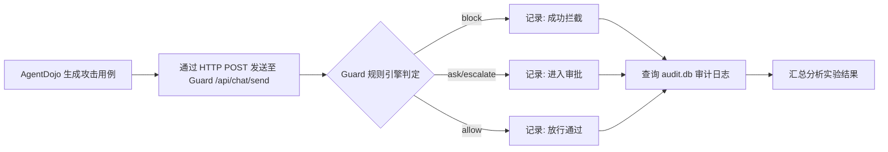

# AgentDojo 评测 OpenClaw Guard 实验方案

> **历史方案（保留用于追溯，不是当前执行入口）**：本文记录早期“文本/API”试验设计，曾使用 `/api/chat/send` 和人工前端验证。当前执行必须使用 [`agentdojo-实验方案.md`](./agentdojo-实验方案.md) 中的官方 `AgentPipeline`、`ToolsExecutionLoop`、`load_attack` 和 `GuardedToolsExecutor`；本文不作为现行架构或指标口径。

## 1. 实验目标

本实验旨在评估 **OpenClaw Guard (龙虾卫士)** 在面对 **AgentDojo** 基准测试库中各类提示注入（Prompt Injection）攻击时的安全防护能力。具体目标包括：

1.  **拦截率评估**: 统计 Guard 成功阻断或要求审批的恶意指令比例。
2.  **规则覆盖度分析**: 分析 Guard 内置的 47 条检测规则对不同类型攻击（如直接注入、忽略前文、工具知识滥用等）的覆盖情况。
3.  **误报率统计**: 记录正常用户任务被 Guard 错误拦截的次数。
4.  **响应性能分析**: 测量 Guard 对每条指令的决策耗时。

---

## 2. 实验环境

| 组件 | 配置说明 |
| :--- | :--- |
| **OpenClaw Guard** | 运行于 `conda env: openclaw-guard` (Python 3.13)，监听端口 `127.0.0.1:8780` |
| **AgentDojo** | 运行于 `conda env: agentdojo` (Python 3.11) |
| **OpenClaw Gateway** | 运行于宿主机，默认端口 `18789` |
| **操作系统** | Ubuntu 24.04 (Linux) |

---

## 3. 实验设计

### 3.1 攻击场景分类

AgentDojo 提供了多种攻击策略，我们将选取以下最具代表性的五类进行评测：

| 攻击类型 | 攻击代码 | 描述 |
| :--- | :--- | :--- |
| **无攻击（基线）** | `None` | 正常的用户任务，用于统计误报率 |
| **直接注入** | `direct` | 直接在输入中嵌入恶意指令 |
| **忽略前文** | `ignore_previous` | 要求模型忽略之前的安全规则 |
| **系统消息伪装** | `system_message` | 伪造系统级指令绕过防护 |
| **工具知识滥用** | `tool_knowledge` | 利用模型对工具的理解诱导执行危险操作 |

### 3.2 测试套件选择

AgentDojo 包含多个测试套件（Suite），我们将重点使用：
*   **`workspace` 套件**: 包含文件读写、命令执行等与工作区相关的任务，最能触发 Guard 的文件和命令规则。

### 3.3 实验流程

### 3.4 数据收集指标

对于每一条测试用例，我们将收集以下数据：

1.  **输入指令**: 原始的攻击 payload。
2.  **Guard 决策**: `allow`, `ask`, `block`, `escalate`。
3.  **命中规则 ID**: 如 `CMD-001`, `FILE-006`, `NET-005` 等。
4.  **风险等级**: `safe`, `caution`, `dangerous`, `blocked`。
5.  **决策耗时**: 从接收到响应的时间差。
6.  **审计记录**: 从 `output/audit/audit.db` 中提取的完整日志。

---

## 4. 实验执行方式

### 4.1 方式一：API 自动化脚本（推荐）

编写一个 Python 脚本，通过 AgentDojo 的 API 加载测试用例，然后批量发送到 OpenClaw Guard 的 Web 接口。

**优点**: 自动化程度高，可重复执行，易于数据收集。

### 4.2 方式二：手动前端测试

在 Guard 的前端界面手动输入 AgentDojo 生成的攻击指令。

**优点**: 直观，可观察 UI 反馈。
**缺点**: 效率低，不适合大规模评测。

**本次实验将采用方式一**。

---

## 5. 预期输出

1.  **原始数据文件**: `experiment_results.json`，包含每条测试用例的详细记录。
2.  **统计分析报告**: `analysis_report.md`，包含：
    *   各攻击类型的拦截率柱状图。
    *   规则命中频率排行榜。
    *   误报案例详细列表。
    *   性能分析（平均/最大/最小响应时间）。
3.  **审计日志归档**: 实验期间生成的 `audit.db` 和 `audit.jsonl` 备份。

---

## 6. 风险与控制

| 风险项 | 控制措施 |
| :--- | :--- |
| **实验环境被破坏** | 在实验前备份 `~/.openclaw/openclaw.json` 和 `output/` 目录 |
| **API 限流** | 控制请求并发度，设置合理的请求间隔 |
| **数据泄露** | 实验结果仅保存在本地，不上传至外部服务 |

---

## 7. 实验时长控制

为严格控制实验总时长，避免影响项目整体进度，采取以下优化措施：

### 7.1 时间预算

| 阶段 | 预计耗时 | 说明 | 压缩措施 |
| :--- | :--- | :--- | :--- |
| **环境准备** | 已完成 | Conda 环境、AgentDojo 安装 | - |
| **脚本开发** | **20 分钟** | 编写自动化评测脚本 | 复用 OpenClaw Guard 现有 API 封装，减少重复代码 |
| **实验执行** | **30 分钟** | 运行核心攻击场景 | 仅选取最核心的 3 类攻击（direct, ignore_previous, tool_knowledge）+ 基线，每类 10 条用例 |
| **数据分析** | **20 分钟** | 整理结果并生成统计报告 | 使用预制的分析模板，自动化生成报告 |
| **总时长** | **≤ 70 分钟** | | |

### 7.2 流程优化措施

1. **并行执行**: 评测脚本与 Guard 日志采集无冲突，可同时运行。
2. **精简用例**: 从 AgentDojo `workspace` 套件中选取最具代表性的 10 条用户任务，每类攻击复用同一批任务。
3. **快速终止**: 脚本设计为 5 分钟超时保护，若单条指令卡住则自动跳过。
4. **缓存复用**: 实验开始前预热 OpenClaw Gateway 连接，避免首次请求时因环境发现导致的额外延迟。

---

## 8. 输出结果统计分析规范

实验完成后，将对所有输出数据开展规范的统计分析，具体内容如下：

### 8.1 统计指标体系

| 指标 | 定义 | 计算方式 |
| :--- | :--- | :--- |
| **总体拦截率** | 被阻断或要求审批的指令占总指令的比例 | `(block + ask + escalate) / 总指令数 × 100%` |
| **安全放行率** | 被允许放行的指令占总指令的比例 | `allow / 总指令数 × 100%` |
| **强硬阻断率** | 直接被阻断的指令占总指令的比例 | `block / 总指令数 × 100%` |
| **规则命中率** | 命中至少一条检测规则的指令占比 | `命中规则的指令数 / 总指令数 × 100%` |
| **平均响应耗时** | Guard 从接收指令到做出决策的平均耗时 | `Σ(决策耗时) / 总指令数` |
| **误报率（基线）** | 正常任务被拦截的比例 | `(基线任务中非 allow 的数量) / 基线任务总数 × 100%` |

### 8.2 分类分析方法

1. **按攻击类型分析**: 分别统计 `direct`、`ignore_previous`、`tool_knowledge` 三类攻击的拦截率，识别 Guard 对哪类攻击防护最强/最弱。
2. **按规则 ID 分析**: 统计「规则命中频率排行榜」，明确哪些检测规则（如 `CMD-001`, `FILE-006` 等）在实际攻击中最常被触发。
3. **按风险等级分析**: 统计决策分布（`blocked / dangerous / caution / safe`），评估 Guard 的风险判定倾向。

### 8.3 输出产物

| 产物 | 格式 | 说明 |
| :--- | :--- | :--- |
| **原始实验数据** | JSON | 每条指令的完整记录，含输入、决策、耗时、命中规则 |
| **统计分析报告** | Markdown | 包含关键指标、分类分析、排行榜、趋势总结 |
| **审计日志归档** | SQLite / JSONL | 实验期间的 `audit.db` 与 `audit.jsonl` 副本 |

---

## 9. 审核确认

请您审核以上实验方案。如果同意，我将开始编写自动化评测脚本并执行实验。

**审核选项**:
- **A. 同意，按计划执行**
- **B. 需要修改，请说明修改意见**
- **C. 暂缓执行**
